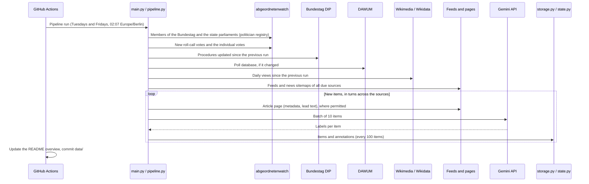

# German Politics Dataset
[](https://github.com/kleinnconrad/german_politics_dataset/actions/workflows/ci.yml)

> [!IMPORTANT]
> **The DIP API key expires on 31 May 2027.** Before that date, take the current key from the [DIP help page](https://dip.bundestag.de/%C3%BCber-dip/hilfe/api), replace the repository secret `DIP_API_KEY` (**Settings > Secrets and variables > Actions**) and the value in your local `.env`, and update the expiry date in `.github/workflows/pipeline.yml` (`DIP_KEY_VALID_UNTIL`) and in this note. The pipeline workflow shows a warning from 45 days before the date and fails from 14 days before, so that GitHub sends a notification.

A dataset of German politics for political analysis and the prediction of elections and other political events. A pipeline in GitHub Actions runs twice a week (Tuesdays and Fridays). It collects opinion polls, roll-call votes, parliamentary procedures, Wikipedia pageviews, news articles and press releases from public APIs, feeds and websites without bot protection, labels the news and press releases with Google Gemini (`gemini-2.5-flash`), and stores everything as partitioned JSON files in this repository.

## Table of Contents
- [Dataset Overview](#dataset-overview)
- [Datasets](#datasets)
- [Sources and Fetch Rules](#sources-and-fetch-rules)
- [Pipeline](#pipeline)
- [Data Files](#data-files)
- [Workflows](#workflows)
- [Configuration](#configuration)
- [Running Locally](#running-locally)
- [Continuous Integration](#continuous-integration)
- [Setup](#setup)
- [License](#license)

## Dataset Overview
<!-- DATASET_OVERVIEW_START -->
No data yet. This section is updated after every pipeline run.
<!-- DATASET_OVERVIEW_END -->

## Datasets

| Dataset | Content | Source | Kind |
|---|---|---|---|
| `polls` | Opinion polls (Sonntagsfrage) for the Bundestag, the 16 state parliaments and the European Parliament, since 2017 | DAWUM | event |
| `wikipedia_pageviews` | Daily views of the German Wikipedia articles of parties (since July 2015) and members of parliament | Wikimedia | event |
| `news_items` | Metadata of political news articles of German outlets | RSS feeds, news sitemaps, article pages | event |
| `press_releases` | Metadata of press releases of the federal government, ministries, parliaments, parliamentary groups, parties and courts | RSS feeds | event |
| `text_annotations` | Gemini labels of news articles and press releases: topic, event types, parties and politicians with role and tone, frame, conflicts, polls, upcoming events | Gemini | event |
| `roll_call_votes` | Roll-call votes of the Bundestag with counts, cohesion and defectors per parliamentary group, and the printed papers (Drucksachen) they refer to | abgeordnetenwatch.de | event |
| `mp_votes` | The vote of each member in each roll-call vote | abgeordnetenwatch.de | event |
| `parliamentary_procedures` | Procedures of the Bundestag and Bundesrat (bills, motions, interpellations), recorded when they appear or change | Bundestag DIP | change |
| `politicians` | Members of the Bundestag and the 16 state parliaments with party, mandates and Wikidata id, recorded when they appear or change | abgeordnetenwatch.de | change |

**Fields of every record:** `record_id`, `revision`, `dataset`, `schema_version`, `observed_at`, `source_id`, `source_url`, `license`, `jurisdiction`, `backfilled`. All other fields are defined with descriptions in [src/schema.py](src/schema.py); the variables and the prediction targets they serve are described in [project_architecture.md](project_architecture.md).

**Point-in-time correctness.** `observed_at` is the time at which the pipeline observed the item. Filtering `observed_at <= t` gives the state of knowledge at time t, so that models can be tested on past data without information from the future. Records of items that are older than the start of collection (e.g. the poll history) have `backfilled: true`.

**Revisions.** Event datasets store each item once. If a source changes an item (e.g. DAWUM corrects a poll), a new record with the same `record_id` and the next `revision` is written. Change datasets write a record for each observed change. The valid version at time t is the record with the highest revision observed at or before t.

**No full texts.** News articles and press releases are stored as titles, URLs, metadata and derived variables. The lead text that Gemini reads is not stored.

## Sources and Fetch Rules

- **APIs:** DAWUM (polls), abgeordnetenwatch.de API v2 (politicians, roll-call votes; at most 30 requests per minute), Bundestag DIP API (procedures; API key), Wikimedia Pageviews API, MediaWiki and Wikidata APIs (article titles). These documented APIs are used under their API terms.
- **Websites:** the news outlets and press-release sources in [config/sources.toml](config/sources.toml), read through RSS/Atom feeds, news sitemaps and, where permitted, the article pages.
- **robots.txt:** every website request is checked against the robots.txt of its host for the user agent `GermanPoliticsDataset`, with the longest-match rule of RFC 9309. A crawl delay is honored; a host that requires more than 120 seconds is not fetched.
- **Bot protection:** a source that answers with HTTP 401/403, a challenge page or a CAPTCHA is set to `blocked` and is not fetched again until it is reset by hand. The pipeline does not use a headless browser.
- **Text and data mining reservations:** a source whose host or pages declare a machine-readable reservation (TDMRep header, `/.well-known/tdmrep.json` or meta tag) is set to `tdm_reserved` and is not used. For outlets whose robots.txt states a reservation under § 44b UrhG in plain text, article pages are not fetched (`fetch_pages = false`); their feed items are used with title and teaser only.
- **Pacing:** at most one request per second per host (abgeordnetenwatch: one per 2.1 seconds), retries for server errors and rate limits.
- **Broken sources:** a source whose feeds fail on 7 consecutive runs is `broken` and is retried weekly.

## Pipeline



Each collector runs in isolation: a failure is logged in `data/state/collectors.json` and the run log, the other collectors continue, and the data already written is kept. The run then ends with exit code 1, so that the workflow fails visibly.

## Data Files

| Path | Content |
|---|---|
| `data/<dataset>/year=YYYY/month=MM/<dataset>_YYYY-MM-DD.json` | Records of a dataset observed on one UTC day |
| `data/state/seen/<dataset>.json` | Items already written, with content hash and revision |
| `data/state/collectors.json` | First run, last run, failures and cursor per collector |
| `data/state/sources.json` | Health status of the news and press-release sources |
| `data/state/politicians.json` | Politician registry used to resolve names in the annotations |
| `data/state/run_log.jsonl` | One line per run with the outcome and counters of each collector |
| `data/LICENSE.md` | License and attribution of the data |

Each data file is a JSON list with one record per line. The folder names `year=` and `month=` let DuckDB, Polars and pyarrow read a dataset as one table:

```python
import duckdb
polls = duckdb.sql("select * from read_json('data/polls/**/*.json', hive_partitioning=true)").df()
```

## Workflows

| Workflow | Schedule | Purpose |
|---|---|---|
| `pipeline.yml` | Tuesdays and Fridays, 02:07 Europe/Berlin | Runs all collectors, updates the overview and commits `data/` and `README.md` |
| `ci.yml` | Pull requests, pushes to `main` | Lint, tests and commit message checks |

**Manual runs.** Both workflows can be started by hand: open the **Actions** tab, select **German Politics Pipeline** (or **CI**), click **Run workflow**, and choose the branch and the `mode`. The button appears once the workflow file is on the default branch. The modes of `pipeline.yml`:
- `normal`: same as the scheduled run; commits the data.
- `shadow`: runs on a copy of the state in a temporary folder and uploads the output as an artifact; nothing is committed. Uses the same API keys and quotas.
- `dry-run`: runs all collectors without writing any data; the feeds collector reads the feeds and sitemaps only (no article pages, no Gemini calls). The run log in the workflow output lists the counts.

For a first test, start with `dry-run` (checks access to the sources), then `shadow` (checks the API keys and the full run without committing), then `normal`.

## Configuration

| Variable | Default | Purpose |
|---|---|---|
| `GEMINI_API_KEY` | none | Gemini API key (required for news and press releases) |
| `DIP_API_KEY` | none | Bundestag DIP API key (required for the procedures) |
| `GEMINI_MODEL` | `gemini-2.5-flash` | Model for the annotation; stored in every annotation record |
| `MAX_GEMINI_CALLS_PER_RUN` | 250 | Gemini requests per run, including retries |
| `MAX_ANNOTATIONS_PER_RUN` | 2500 | News articles and press releases processed per run |
| `NEWS_LOOKBACK_HOURS` | 96 | Age limit of new feed and sitemap items |
| `NEWS_FETCH_PAGES` | on | Fetch article pages for metadata and lead text |
| `COLLECTORS` | all | Comma-separated list of collectors to run |

Fixed thresholds, such as the source status rules, are constants in the modules that use them.

## Running Locally

```bash
uv sync
uv run python src/main.py --dry-run                              # read the feeds only
uv run python src/main.py --collectors polls,wikipedia_pageviews # selected collectors
uv run python src/main.py --max-annotations 20                   # a short full run
uv run python src/generate_dataset_overview.py                   # README overview
```

Secrets are read from a `.env` file in the repository root (`GEMINI_API_KEY=...`, `DIP_API_KEY=...`); the file is listed in `.gitignore`. Local runs write to `~/Downloads/german_politics_dataset/` unless `--output-dir` is given; in GitHub Actions they write to `data/`. The collectors are `politicians`, `roll_call_votes`, `parliamentary_procedures`, `polls`, `wikipedia_pageviews` and `feeds`.

## Continuous Integration

The `CI` workflow runs on every pull request and on pushes to `main`:

| Job | Checks |
|---|---|
| `Lint` | `uv.lock` matches `pyproject.toml`; `ruff check`; `actionlint` (including `shellcheck`) on the workflow files |
| `Tests` | The tests in `tests/` on Python 3.11 and 3.14. They run offline, with a fake web and a fake Gemini client, and check that every module imports with the locked dependencies. |
| `Conventional Commits` | Every commit of a pull request follows the Conventional Commits format (pull requests only) |
| `CI passed` | Succeeds only if all jobs above succeeded or were skipped; use it as the required status check of `main` |

Dependencies are managed with [uv](https://docs.astral.sh/uv/): `pyproject.toml` declares them, `uv.lock` pins them, and Dependabot proposes weekly updates. Run the checks locally before pushing:

```bash
uv lock --check
uv run ruff check .
uv run pytest
```

## Setup

1. Add the repository secrets `GEMINI_API_KEY` and `DIP_API_KEY` under **Settings > Secrets and variables > Actions**. The current public DIP key is listed on the [DIP help page](https://dip.bundestag.de/%C3%BCber-dip/hilfe/api); it is replaced from time to time.
2. Allow workflows to push to the repository under **Settings > Actions > General > Workflow permissions** (read and write permissions).
3. The first run imports the history: all polls since 2017, the pageviews of the party articles since July 2015 and of the members of parliament for one year, and all procedures of the current electoral period. The roll-call votes of the current and the previous electoral period (about 250) are imported over the first three runs, at most 120 per run, to stay within the rate limit of abgeordnetenwatch. The first run takes longer than later runs.

## License

- **Code:** MIT License, see [LICENSE](LICENSE).
- **Data** (`data/`): Open Database License (ODbL) 1.0, individual contents under the Database Contents License (DbCL) 1.0, see [data/LICENSE.md](data/LICENSE.md). The poll data comes from [DAWUM](https://dawum.de/) under the ODbL. Titles and URLs of news articles and press releases remain subject to the rights of their publishers.
