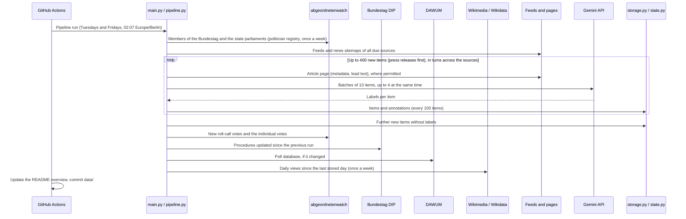

# German Politics Dataset
[](https://github.com/kleinnconrad/dataset.politics.germany/actions/workflows/ci.yml)

> [!IMPORTANT]
> **The DIP API key expires on 31 May 2027.** Before that date, take the current key from the [DIP help page](https://dip.bundestag.de/%C3%BCber-dip/hilfe/api), replace the repository secret `DIP_API_KEY` (**Settings > Secrets and variables > Actions**) and the value in your local `.env`, and update the expiry date in `.github/workflows/pipeline.yml` (`DIP_KEY_VALID_UNTIL`) and in this note. The pipeline workflow shows a warning from 45 days before the date and fails from 14 days before, so that GitHub sends a notification.

A dataset of German politics for political analysis and the prediction of elections and other political events. A pipeline in GitHub Actions runs twice a week (Tuesdays and Fridays) for at most 30 minutes. It collects opinion polls, roll-call votes, parliamentary procedures, Wikipedia pageviews, news articles and press releases from public APIs, feeds and websites without bot protection, labels the news and press releases with Google Gemini (`gemini-2.5-flash`), and stores everything as partitioned JSON files in this repository.

## Table of Contents
- [Dataset Overview](#dataset-overview)
- [Datasets](#datasets)
  - [News Items and Press Releases](#news-items-and-press-releases)
- [Data Model](#data-model)
- [Example Records](#example-records)
- [Sources and Fetch Rules](#sources-and-fetch-rules)
- [Pipeline](#pipeline)
- [Data Files](#data-files)
- [Workflows](#workflows)
- [Configuration](#configuration)
- [Running Locally](#running-locally)
- [Continuous Integration](#continuous-integration)
- [Setup](#setup)
- [License](#license)

## Dataset Overview
<!-- DATASET_OVERVIEW_START -->
**Last updated:** 2026-10-23 04:52 UTC

| Dataset | Records | Items | Files | Observed | Content |
|---|---|---|---|---|---|
| `polls` | 3,988 | 3,988 | 2 | 2026-10-19 to 2026-10-23 | One published opinion poll (Sonntagsfrage). |
| `wikipedia_pageviews` | 993 | 993 | 1 | 2026-10-19 to 2026-10-19 | Daily views of the German Wikipedia article of a party or politician. |
| `news_items` | 5,296 | 5,296 | 2 | 2026-10-20 to 2026-10-23 | Metadata of one news article. The text is not stored. |
| `press_releases` | 250 | 250 | 2 | 2026-10-20 to 2026-10-23 | Metadata of one press release. The text is not stored. |
| `text_annotations` | 796 | 796 | 2 | 2026-10-20 to 2026-10-23 | Gemini labels of one news article or press release. |
| `roll_call_votes` | 247 | 247 | 1 | 2026-10-19 to 2026-10-19 | One roll-call vote (namentliche Abstimmung) in the Bundestag. |
| `mp_votes` | 172,677 | 172,677 | 1 | 2026-10-19 to 2026-10-19 | The vote of one member in one roll-call vote. |
| `parliamentary_procedures` | 19,533 | 19,374 | 2 | 2026-10-19 to 2026-10-23 | One parliamentary procedure (Vorgang) in the DIP, recorded when it appears or changes. |
| `politicians` | 2,513 | 2,513 | 1 | 2026-10-19 to 2026-10-19 | A politician with a current mandate, recorded when the entry appears or changes. |

**Runs**

- **Latest run:** 2026-10-23 04:35 UTC (normal)
  - `feeds`: ok (news_items 2,724, press_releases 122, text_annotations 398)
  - `parliamentary_procedures`: ok (parliamentary_procedures 268)
  - `politicians`: not_due
  - `polls`: ok (polls 8)
  - `roll_call_votes`: ok
  - `wikipedia_pageviews`: not_due

**Sources**

- **News outlets:** 40 configured (40 active)
- **Press-release sources:** 27 configured (26 active, 1 removed)

<details>
<summary>News outlets: items per source</summary>

| Source | Type | Status | Items | Last 30 days | Annotated | With lead text | Latest publication |
|---|---|---|---|---|---|---|---|
| Augsburger Allgemeine | regional daily | active | 185 | 185 | 7.6% (14) | 0.0% (0) | 2026-10-23 |
| Berliner Zeitung | regional daily | active | 67 | 67 | 20.9% (14) | 20.9% (14) | 2026-10-23 |
| Bild | tabloid | active | 320 | 320 | 4.4% (14) | 4.4% (14) | 2026-10-23 |
| BR24 | public broadcaster regional | active | 70 | 70 | 21.4% (15) | 0.0% (0) | 2026-10-23 |
| buten un binnen | public broadcaster regional | active | 7 | 7 | 100.0% (7) | 0.0% (0) | 2026-10-22 |
| Der Spiegel | weekly magazine | active | 168 | 168 | 8.3% (14) | 0.0% (0) | 2026-10-23 |
| Der Tagesspiegel | national daily | active | 240 | 240 | 5.8% (14) | 0.0% (0) | 2026-10-23 |
| Deutschlandfunk | public broadcaster national | active | 15 | 15 | 80.0% (12) | 80.0% (12) | 2026-10-22 |
| Die Welt | national daily | active | 417 | 417 | 3.4% (14) | 1.9% (8) | 2026-10-23 |
| Focus Online | weekly magazine | active | 221 | 221 | 6.3% (14) | 5.4% (12) | 2026-10-22 |
| Freie Presse | regional daily | active | 22 | 22 | 63.6% (14) | 0.0% (0) | 2026-10-22 |
| Hamburger Abendblatt | regional daily | active | 218 | 218 | 5.5% (12) | 2.3% (5) | 2026-10-23 |
| Handelsblatt | business | active | 146 | 146 | 9.6% (14) | 9.6% (14) | 2026-10-23 |
| hessenschau.de | public broadcaster regional | active | 13 | 13 | 84.6% (11) | 0.0% (0) | 2026-10-22 |
| Lausitzer Rundschau | regional daily | active | 93 | 93 | 15.1% (14) | 0.0% (0) | 2026-10-23 |
| MDR | public broadcaster regional | active | 82 | 82 | 17.1% (14) | 0.0% (0) | 2026-10-23 |
| n-tv.de | online only | active | 229 | 229 | 6.1% (14) | 6.1% (14) | 2026-10-23 |
| NDR | public broadcaster regional | active | 35 | 35 | 40.0% (14) | 0.0% (0) | 2026-10-22 |
| Neue Osnabrücker Zeitung | regional daily | active | 502 | 502 | 2.8% (14) | 0.0% (0) | 2026-10-23 |
| Nordkurier | regional daily | active | 158 | 158 | 8.9% (14) | 8.9% (14) | 2026-10-23 |
| Nürnberger Nachrichten | regional daily | active | 58 | 58 | 24.1% (14) | 0.0% (0) | 2026-10-23 |
| rbb24 | public broadcaster regional | active | 28 | 28 | 50.0% (14) | 0.0% (0) | 2026-10-22 |
| Rheinische Post | regional daily | active | 184 | 184 | 7.6% (14) | 0.0% (0) | 2026-10-23 |
| Saarbrücker Zeitung | regional daily | active | 27 | 27 | 51.9% (14) | 51.9% (14) | 2026-10-23 |
| shz.de | regional daily | active | 182 | 182 | 7.7% (14) | 0.0% (0) | 2026-10-23 |
| Stuttgarter Zeitung | regional daily | active | 118 | 118 | 11.9% (14) | 0.0% (0) | 2026-10-23 |
| SWR Aktuell | public broadcaster regional | active | 27 | 27 | 51.9% (14) | 0.0% (0) | 2026-10-23 |
| Süddeutsche Zeitung | national daily | active | 47 | 47 | 29.8% (14) | 0.0% (0) | 2026-10-23 |
| Südkurier | regional daily | active | 97 | 97 | 14.4% (14) | 0.0% (0) | 2026-10-23 |
| t-online | online only | active | 143 | 143 | 9.8% (14) | 0.0% (0) | 2026-10-23 |
| tagesschau.de | public broadcaster national | active | 122 | 122 | 12.3% (15) | 0.0% (0) | 2026-10-23 |
| taz | national daily | active | 106 | 106 | 13.2% (14) | 0.0% (0) | 2026-10-22 |
| Thüringer Allgemeine | regional daily | active | 185 | 185 | 5.9% (11) | 0.5% (1) | 2026-10-23 |
| Trierischer Volksfreund | regional daily | active | 48 | 48 | 29.2% (14) | 29.2% (14) | 2026-10-23 |
| Volksstimme | regional daily | active | 207 | 207 | 6.8% (14) | 0.0% (0) | 2026-10-23 |
| WAZ | regional daily | active | 162 | 162 | 8.6% (14) | 3.1% (5) | 2026-10-22 |
| WDR | public broadcaster regional | active | 63 | 63 | 22.2% (14) | 0.0% (0) | 2026-10-23 |
| Weser-Kurier | regional daily | active | 33 | 33 | 42.4% (14) | 0.0% (0) | 2026-10-23 |
| Wiesbadener Kurier | regional daily | active | 120 | 120 | 11.7% (14) | 0.0% (0) | 2026-10-23 |
| ZDFheute | public broadcaster national | active | 131 | 131 | 11.5% (15) | 9.2% (12) | 2026-10-23 |

</details>

<details>
<summary>Press-release sources: items per source</summary>

| Source | Type | Status | Items | Last 30 days | Annotated | With lead text | Latest publication |
|---|---|---|---|---|---|---|---|
| AfD | party | active | 5 | 5 | 100.0% (5) | 100.0% (5) | 2026-10-21 |
| AfD-Fraktion im Bundestag | parliamentary group | active | 17 | 17 | 100.0% (17) | 100.0% (17) | 2026-10-22 |
| Bayerische Staatsregierung | state government | active | 84 | 84 | 100.0% (84) | 97.6% (82) | 2026-10-22 |
| Bundesministerium der Justiz und für Verbraucherschutz | federal ministry | active | 2 | 2 | 100.0% (2) | 100.0% (2) | 2026-10-21 |
| Bundesministerium der Verteidigung | federal ministry | active | 10 | 10 | 100.0% (10) | 0.0% (0) | 2026-10-22 |
| Bundesministerium des Innern | federal ministry | active | 0 | 0 | 0.0% (0) | 0.0% (0) | none |
| Bundesministerium für Bildung, Familie, Senioren, Frauen und Jugend | federal ministry | active | 3 | 3 | 100.0% (3) | 100.0% (3) | 2026-10-20 |
| Bundesministerium für Digitales und Staatsmodernisierung | federal ministry | active | 1 | 1 | 100.0% (1) | 100.0% (1) | 2026-10-16 |
| Bundesministerium für Gesundheit | federal ministry | active | 0 | 0 | 0.0% (0) | 0.0% (0) | none |
| Bundesministerium für Umwelt, Klimaschutz, Naturschutz und nukleare Sicherheit | federal ministry | active | 5 | 5 | 100.0% (5) | 0.0% (0) | 2026-10-21 |
| Bundesministerium für wirtschaftliche Zusammenarbeit und Entwicklung | federal ministry | active | 0 | 0 | 0.0% (0) | 0.0% (0) | none |
| Bundesministerium für Wohnen, Stadtentwicklung und Bauwesen | federal ministry | active | 0 | 0 | 0.0% (0) | 0.0% (0) | none |
| Bundesrat | bundesrat | active | 0 | 0 | 0.0% (0) | 0.0% (0) | none |
| Bundesregierung | federal government | active | 20 | 20 | 100.0% (20) | 100.0% (20) | 2026-10-22 |
| Bündnis 90/Die Grünen Bundestagsfraktion | parliamentary group | active | 6 | 6 | 100.0% (6) | 100.0% (6) | 2026-10-19 |
| Bündnis Sahra Wagenknecht | party | active | 1 | 1 | 100.0% (1) | 100.0% (1) | 2026-10-20 |
| CDU | party | active | 4 | 4 | 100.0% (4) | 100.0% (4) | 2026-10-21 |
| CSU | party | active | 0 | 0 | 0.0% (0) | 0.0% (0) | none |
| Deutscher Bundestag | bundestag | active | 55 | 55 | 100.0% (55) | 100.0% (55) | 2026-10-22 |
| Die Linke | party | active | 1 | 1 | 100.0% (1) | 100.0% (1) | 2026-10-17 |
| FDP | party | active | 12 | 12 | 100.0% (12) | 100.0% (12) | 2026-10-22 |
| Fraktion Die Linke im Bundestag | parliamentary group | active | 17 | 17 | 100.0% (17) | 100.0% (17) | 2026-10-22 |
| Niedersächsische Landesregierung | state government | active | 0 | 0 | 0.0% (0) | 0.0% (0) | none |
| Saarländische Landesregierung | state government | removed | 0 | 0 | 0.0% (0) | 0.0% (0) | none |
| Senatskanzlei Berlin | state government | active | 6 | 6 | 100.0% (6) | 83.3% (5) | 2026-10-23 |
| SPD | party | active | 0 | 0 | 0.0% (0) | 0.0% (0) | none |
| SPD-Bundestagsfraktion | parliamentary group | active | 1 | 1 | 100.0% (1) | 100.0% (1) | 2026-10-21 |

</details>

**Annotations**

- **Annotated items:** 796 of 5,546 (14.4%)
- **Text seen by the model:** title_only 2,728, title_teaser 2,433, lead_text 385

**Main topics of political items, last 30 days** (697 items)

| Topic | Items | Share |
|---|---|---|
| Government operations | 160 | 23.0% |
| International affairs | 102 | 14.6% |
| Law and crime | 62 | 8.9% |
| Civil rights and liberties | 47 | 6.7% |
| Health | 31 | 4.4% |
| Technology | 31 | 4.4% |
| Macroeconomics | 31 | 4.4% |
| Defense | 30 | 4.3% |
| Environment | 27 | 3.9% |
| Social welfare | 25 | 3.6% |

**Fields** (Filled: records with a value that is not null and not empty)

<details>
<summary><code>polls</code>: 21 fields</summary>

| Field | Description | Filled | Distinct values |
|---|---|---|---|
| `record_id` | Stable id of the item. Together with revision it identifies a record. | 100.0% (3,988) | 3,988 |
| `revision` | 0 for the first observation; incremented each time the source changes the item. | 100.0% (3,988) | 1 |
| `dataset` | Name of the dataset. | 100.0% (3,988) | 1 |
| `schema_version` | Version of the record schema. | 100.0% (3,988) | 1 |
| `observed_at` | UTC time at which the pipeline observed this version of the item. Filtering observed_at <= t gives the state of knowledge at time t. | 100.0% (3,988) | 3 |
| `source_id` | Id of the source (API, outlet or press source). | 100.0% (3,988) | 1 |
| `source_url` | URL of the item or of the API resource it was read from. | 100.0% (3,988) | 1 |
| `license` | License or terms of the source. | 100.0% (3,988) | 1 |
| `jurisdiction` | DE for the federal level, ISO 3166-2 code for a state. | 100.0% (3,988) | 17 |
| `backfilled` | True if the item is older than the start of collection for its dataset, so that observed_at does not reflect when it became public. | 100.0% (3,988) | 2 |
| `poll_id` | Id of the poll at DAWUM. | 100.0% (3,988) | 3,988 |
| `parliament` | Parliament the poll asks about. | 100.0% (3,988) | 3 |
| `institute` | Polling institute. | 100.0% (3,988) | 22 |
| `tasker` | Client that commissioned the poll. | 100.0% (3,988) | 119 |
| `method` | Survey method. | 100.0% (3,988) | 6 |
| `fieldwork_start` | First day of the fieldwork. | 100.0% (3,988) | 2,166 |
| `fieldwork_end` | Last day of the fieldwork. | 100.0% (3,988) | 2,210 |
| `published_date` | Publication date of the poll. | 100.0% (3,988) | 2,435 |
| `sample_size` | Number of respondents. | 100.0% (3,988) | 1,061 |
| `results` | Vote intention in percent by party code, without the others. | 100.0% (3,988) | 25 |
| `others_share` | Share of all other parties in percent. | 100.0% (3,988) | 64 |

</details>

<details>
<summary><code>wikipedia_pageviews</code>: 15 fields</summary>

| Field | Description | Filled | Distinct values |
|---|---|---|---|
| `record_id` | Stable id of the item. Together with revision it identifies a record. | 100.0% (993) | 993 |
| `revision` | 0 for the first observation; incremented each time the source changes the item. | 100.0% (993) | 1 |
| `dataset` | Name of the dataset. | 100.0% (993) | 1 |
| `schema_version` | Version of the record schema. | 100.0% (993) | 1 |
| `observed_at` | UTC time at which the pipeline observed this version of the item. Filtering observed_at <= t gives the state of knowledge at time t. | 100.0% (993) | 148 |
| `source_id` | Id of the source (API, outlet or press source). | 100.0% (993) | 1 |
| `source_url` | URL of the item or of the API resource it was read from. | 100.0% (993) | 993 |
| `license` | License or terms of the source. | 100.0% (993) | 1 |
| `jurisdiction` | DE for the federal level, ISO 3166-2 code for a state. | 100.0% (993) | 1 |
| `backfilled` | True if the item is older than the start of collection for its dataset, so that observed_at does not reflect when it became public. | 100.0% (993) | 1 |
| `entity_id` | Party code, or politician id at abgeordnetenwatch. | 100.0% (993) | 993 |
| `entity_type` | Type of the entity. | 100.0% (993) | 2 |
| `wikipedia_title` | Title of the article in the German Wikipedia. | 100.0% (993) | 993 |
| `wikidata_qid` | Wikidata id of the entity. | 98.9% (982) | 982 |
| `daily_views` | Views by human users per day (UTC), for the days since the previous run. | 100.0% (993) | 4,128 |

</details>

<details>
<summary><code>news_items</code>: 30 fields</summary>

| Field | Description | Filled | Distinct values |
|---|---|---|---|
| `record_id` | Stable id of the item. Together with revision it identifies a record. | 100.0% (5,296) | 5,296 |
| `revision` | 0 for the first observation; incremented each time the source changes the item. | 100.0% (5,296) | 1 |
| `dataset` | Name of the dataset. | 100.0% (5,296) | 1 |
| `schema_version` | Version of the record schema. | 100.0% (5,296) | 1 |
| `observed_at` | UTC time at which the pipeline observed this version of the item. Filtering observed_at <= t gives the state of knowledge at time t. | 100.0% (5,296) | 130 |
| `source_id` | Id of the source (API, outlet or press source). | 100.0% (5,296) | 40 |
| `source_url` | URL of the item or of the API resource it was read from. | 100.0% (5,296) | 5,296 |
| `license` | License or terms of the source. | 100.0% (5,296) | 1 |
| `jurisdiction` | DE for the federal level, ISO 3166-2 code for a state. | 100.0% (5,296) | 17 |
| `backfilled` | True if the item is older than the start of collection for its dataset, so that observed_at does not reflect when it became public. | 100.0% (5,296) | 1 |
| `outlet_id` | Id of the outlet. | 100.0% (5,296) | 40 |
| `outlet_type` | Type of the outlet. | 100.0% (5,296) | 8 |
| `owner_group` | Publisher group of the outlet, or 'public' for public broadcasters. | 100.0% (5,296) | 20 |
| `home_state` | State of a regional outlet; null for national outlets. | 56.5% (2,991) | 16 |
| `channel` | Where the article was found: RSS/Atom feed or news sitemap. | 100.0% (5,296) | 2 |
| `url` | URL of the article. | 100.0% (5,296) | 5,296 |
| `canonical_url` | Canonical URL declared by the article page. | 3.5% (188) | 188 |
| `title` | Title of the article. | 100.0% (5,296) | 4,458 |
| `published_at` | Publication time (UTC). | 99.9% (5,293) | 4,378 |
| `updated_at` | Last modification time from the article page (UTC). | 3.0% (158) | 147 |
| `section` | Section of the outlet, from the page, the feed or the URL path. | 35.3% (1,872) | 201 |
| `feed_categories` | Categories of the item in the feed. | 34.9% (1,846) | 1,039 |
| `keywords` | Keywords from the article page or the news sitemap. | 27.5% (1,458) | 3,608 |
| `jsonld_type` | schema.org type of the article page, e.g. NewsArticle or OpinionNewsArticle. | 3.1% (163) | 2 |
| `is_agency_copy` | True if the article is credited to a news agency (dpa, AFP, Reuters, epd, KNA, AP). Null without page data. | 3.1% (163) | 2 |
| `author_count` | Number of named authors. Author names are not stored. Null without page data. | 3.1% (163) | 5 |
| `word_count` | Word count from the article page. Null if not given. | 0.0% (0) | 0 |
| `is_paywalled` | True if the page marks the article as not accessible for free. Null without page data. | 2.2% (117) | 2 |
| `has_video` | True if the article page embeds a video. Null without page data. | 3.6% (190) | 2 |
| `content_basis` | Text available for the annotation: title only, title and teaser, or lead text of the page. | 100.0% (5,296) | 3 |

</details>

<details>
<summary><code>press_releases</code>: 19 fields</summary>

| Field | Description | Filled | Distinct values |
|---|---|---|---|
| `record_id` | Stable id of the item. Together with revision it identifies a record. | 100.0% (250) | 250 |
| `revision` | 0 for the first observation; incremented each time the source changes the item. | 100.0% (250) | 1 |
| `dataset` | Name of the dataset. | 100.0% (250) | 1 |
| `schema_version` | Version of the record schema. | 100.0% (250) | 1 |
| `observed_at` | UTC time at which the pipeline observed this version of the item. Filtering observed_at <= t gives the state of knowledge at time t. | 100.0% (250) | 215 |
| `source_id` | Id of the source (API, outlet or press source). | 100.0% (250) | 18 |
| `source_url` | URL of the item or of the API resource it was read from. | 100.0% (250) | 250 |
| `license` | License or terms of the source. | 100.0% (250) | 1 |
| `jurisdiction` | DE for the federal level, ISO 3166-2 code for a state. | 100.0% (250) | 3 |
| `backfilled` | True if the item is older than the start of collection for its dataset, so that observed_at does not reflect when it became public. | 100.0% (250) | 1 |
| `press_source_id` | Id of the press source. | 100.0% (250) | 18 |
| `actor_type` | Type of the issuing actor. | 100.0% (250) | 6 |
| `party` | Party of a party or parliamentary group; null for other actors. | 25.6% (64) | 7 |
| `url` | URL of the press release. | 100.0% (250) | 250 |
| `canonical_url` | Canonical URL declared by the page. | 40.8% (102) | 102 |
| `title` | Title of the press release. | 100.0% (250) | 246 |
| `published_at` | Publication time (UTC). | 100.0% (250) | 173 |
| `feed_categories` | Categories of the item in the feed. | 31.6% (79) | 75 |
| `content_basis` | Text available for the annotation. | 100.0% (250) | 2 |

</details>

<details>
<summary><code>text_annotations</code>: 41 fields</summary>

| Field | Description | Filled | Distinct values |
|---|---|---|---|
| `record_id` | Stable id of the item. Together with revision it identifies a record. | 100.0% (796) | 796 |
| `revision` | 0 for the first observation; incremented each time the source changes the item. | 100.0% (796) | 1 |
| `dataset` | Name of the dataset. | 100.0% (796) | 1 |
| `schema_version` | Version of the record schema. | 100.0% (796) | 1 |
| `observed_at` | UTC time at which the pipeline observed this version of the item. Filtering observed_at <= t gives the state of knowledge at time t. | 100.0% (796) | 66 |
| `source_id` | Id of the source (API, outlet or press source). | 100.0% (796) | 58 |
| `source_url` | URL of the item or of the API resource it was read from. | 100.0% (796) | 796 |
| `license` | License or terms of the source. | 100.0% (796) | 1 |
| `jurisdiction` | DE for the federal level, ISO 3166-2 code for a state. | 100.0% (796) | 17 |
| `backfilled` | True if the item is older than the start of collection for its dataset, so that observed_at does not reflect when it became public. | 100.0% (796) | 1 |
| `item_dataset` | Dataset of the annotated item. | 100.0% (796) | 2 |
| `item_id` | record_id of the annotated item. | 100.0% (796) | 796 |
| `model` | Gemini model that produced the labels. | 100.0% (796) | 1 |
| `extraction_hash` | Hash of the prompt, response schema and model settings. Labels with the same hash were produced under the same conditions. | 100.0% (796) | 2 |
| `content_basis` | Text the model saw: title only, title and teaser, or lead text. | 100.0% (796) | 3 |
| `is_political` | Whether the item is about politics. | 100.0% (796) | 2 |
| `political_level` | Main political level of the item. | 100.0% (796) | 6 |
| `states_concerned` | States the item is mainly about. | 30.9% (246) | 16 |
| `cap_topic` | Main policy topic (Comparative Agendas Project). | 100.0% (796) | 22 |
| `cap_topics_secondary` | Further policy topics. | 56.4% (449) | 22 |
| `issue_detail` | Specific issue in a few words. | 87.6% (697) | 597 |
| `article_type` | Form of the item. | 100.0% (796) | 7 |
| `event_types` | Types of political events reported. | 78.5% (625) | 19 |
| `event_status` | Stage of the main event. | 100.0% (796) | 4 |
| `government_involved` | Whether a government or its members act or are addressed. | 100.0% (796) | 2 |
| `mentioned_parties` | Parties the item refers to. | 41.3% (329) | 11 |
| `party_roles` | Role of each mentioned party. | 41.3% (329) | 11 |
| `party_tone` | Tone toward each mentioned party. | 41.3% (329) | 11 |
| `quoted_parties` | Parties whose representatives are quoted. | 13.8% (110) | 10 |
| `mentioned_politicians` | abgeordnetenwatch ids of the named politicians that are in the entity registry. | 29.3% (233) | 150 |
| `politician_tone` | Tone toward each resolved politician, by abgeordnetenwatch id. | 29.3% (233) | 150 |
| `unresolved_person_count` | Number of named persons that are not in the entity registry. Their names are not stored. | 100.0% (796) | 7 |
| `overall_tone` | Overall tone of the item. | 100.0% (796) | 4 |
| `government_tone` | Tone toward the federal government. | 100.0% (796) | 5 |
| `frame` | Dominant news frame (Semetko and Valkenburg). | 100.0% (796) | 6 |
| `conflict_pairs` | Pairs of parties reported in dispute, each pair sorted. | 7.0% (56) | 27 |
| `reports_poll` | Whether poll results are reported. | 100.0% (796) | 2 |
| `poll_institute` | Polling institute of a reported poll. | 1.4% (11) | 6 |
| `upcoming_events` | Future events with event_type and date (YYYY-MM-DD). | 10.2% (81) | 41 |
| `communication_type` | Purpose of a press release; 'Not applicable' for news. | 100.0% (796) | 8 |
| `populism_markers` | Populist rhetoric in a press release. | 3.6% (29) | 3 |

</details>

<details>
<summary><code>roll_call_votes</code>: 25 fields</summary>

| Field | Description | Filled | Distinct values |
|---|---|---|---|
| `record_id` | Stable id of the item. Together with revision it identifies a record. | 100.0% (247) | 247 |
| `revision` | 0 for the first observation; incremented each time the source changes the item. | 100.0% (247) | 1 |
| `dataset` | Name of the dataset. | 100.0% (247) | 1 |
| `schema_version` | Version of the record schema. | 100.0% (247) | 1 |
| `observed_at` | UTC time at which the pipeline observed this version of the item. Filtering observed_at <= t gives the state of knowledge at time t. | 100.0% (247) | 13 |
| `source_id` | Id of the source (API, outlet or press source). | 100.0% (247) | 1 |
| `source_url` | URL of the item or of the API resource it was read from. | 100.0% (247) | 247 |
| `license` | License or terms of the source. | 100.0% (247) | 1 |
| `jurisdiction` | DE for the federal level, ISO 3166-2 code for a state. | 100.0% (247) | 1 |
| `backfilled` | True if the item is older than the start of collection for its dataset, so that observed_at does not reflect when it became public. | 100.0% (247) | 2 |
| `vote_id` | Id of the vote at abgeordnetenwatch. | 100.0% (247) | 247 |
| `parliament_period` | Electoral period, e.g. 'Bundestag 2025 - 2029'. | 100.0% (247) | 2 |
| `vote_date` | Date of the vote. | 100.0% (247) | 124 |
| `title` | Title of the vote. | 100.0% (247) | 240 |
| `topics` | Topics assigned by abgeordnetenwatch. | 99.2% (245) | 29 |
| `committees` | Committees in charge. | 79.8% (197) | 26 |
| `printed_papers` | Numbers of the Bundestag printed papers (Drucksachen) linked in the description of the vote, e.g. '21/7869'. They link the vote to procedures in the DIP (filter f.dokumentnummer). | 99.2% (245) | 419 |
| `accepted` | Whether the motion was accepted. | 100.0% (247) | 2 |
| `yes` | Number of yes votes. | 100.0% (247) | 180 |
| `no` | Number of no votes. | 100.0% (247) | 178 |
| `abstain` | Number of abstentions. | 100.0% (247) | 46 |
| `no_show` | Number of members who did not vote. | 100.0% (247) | 104 |
| `by_faction` | Counts of yes, no, abstain and no_show by parliamentary group at the time of the vote (party code, NONE for members without a group). | 100.0% (247) | 8 |
| `cohesion` | Rice index \|yes - no\| / (yes + no) per parliamentary group; null if the group cast no yes or no votes. Members without a group (NONE) are not included. | 100.0% (247) | 7 |
| `defectors` | Members per parliamentary group who voted yes while the group cast more no than yes votes, or no while it cast more yes than no votes. Members without a group (NONE) are not included. | 100.0% (247) | 7 |

</details>

<details>
<summary><code>mp_votes</code>: 16 fields</summary>

| Field | Description | Filled | Distinct values |
|---|---|---|---|
| `record_id` | Stable id of the item. Together with revision it identifies a record. | 100.0% (172,677) | 172,677 |
| `revision` | 0 for the first observation; incremented each time the source changes the item. | 100.0% (172,677) | 1 |
| `dataset` | Name of the dataset. | 100.0% (172,677) | 1 |
| `schema_version` | Version of the record schema. | 100.0% (172,677) | 1 |
| `observed_at` | UTC time at which the pipeline observed this version of the item. Filtering observed_at <= t gives the state of knowledge at time t. | 100.0% (172,677) | 16 |
| `source_id` | Id of the source (API, outlet or press source). | 100.0% (172,677) | 1 |
| `source_url` | URL of the item or of the API resource it was read from. | 100.0% (172,677) | 172,677 |
| `license` | License or terms of the source. | 100.0% (172,677) | 1 |
| `jurisdiction` | DE for the federal level, ISO 3166-2 code for a state. | 100.0% (172,677) | 1 |
| `backfilled` | True if the item is older than the start of collection for its dataset, so that observed_at does not reflect when it became public. | 100.0% (172,677) | 2 |
| `vote_id` | Id of the vote at abgeordnetenwatch. | 100.0% (172,677) | 247 |
| `vote_date` | Date of the vote. | 100.0% (172,677) | 124 |
| `politician_id` | Id of the politician at abgeordnetenwatch. | 100.0% (172,677) | 1,008 |
| `faction` | Parliamentary group at the time of the vote as party code, NONE for members without a group. | 100.0% (172,677) | 8 |
| `vote` | The member's vote. | 100.0% (172,677) | 4 |
| `voted_against_faction` | True if the member voted yes while the group cast more no than yes votes, or no while it cast more yes than no votes. Always false for members without a group. | 100.0% (172,677) | 2 |

</details>

<details>
<summary><code>parliamentary_procedures</code>: 24 fields</summary>

| Field | Description | Filled | Distinct values |
|---|---|---|---|
| `record_id` | Stable id of the item. Together with revision it identifies a record. | 100.0% (19,533) | 19,374 |
| `revision` | 0 for the first observation; incremented each time the source changes the item. | 100.0% (19,533) | 2 |
| `dataset` | Name of the dataset. | 100.0% (19,533) | 1 |
| `schema_version` | Version of the record schema. | 100.0% (19,533) | 1 |
| `observed_at` | UTC time at which the pipeline observed this version of the item. Filtering observed_at <= t gives the state of knowledge at time t. | 100.0% (19,533) | 22 |
| `source_id` | Id of the source (API, outlet or press source). | 100.0% (19,533) | 1 |
| `source_url` | URL of the item or of the API resource it was read from. | 100.0% (19,533) | 19,374 |
| `license` | License or terms of the source. | 100.0% (19,533) | 1 |
| `jurisdiction` | DE for the federal level, ISO 3166-2 code for a state. | 100.0% (19,533) | 1 |
| `backfilled` | True if the item is older than the start of collection for its dataset, so that observed_at does not reflect when it became public. | 100.0% (19,533) | 1 |
| `procedure_id` | Id of the procedure in the DIP. | 100.0% (19,533) | 19,374 |
| `change` | new for the first observation, status_changed if the status changed, updated for other tracked changes. | 100.0% (19,533) | 3 |
| `procedure_type` | Type of the procedure, e.g. Gesetzgebung, Antrag, Kleine Anfrage. | 100.0% (19,533) | 43 |
| `electoral_period` | Electoral period of the Bundestag. | 100.0% (19,533) | 1 |
| `title` | Title of the procedure. | 100.0% (19,533) | 19,099 |
| `initiators` | Initiators, e.g. Bundesregierung, Bundesrat or a parliamentary group. | 40.4% (7,882) | 85 |
| `subject_areas` | Subject areas (Sachgebiete) of the DIP. | 26.7% (5,208) | 28 |
| `descriptors` | Subject descriptors of the DIP thesaurus. | 88.5% (17,288) | 7,920 |
| `consent_required` | Whether the consent of the Bundesrat is required, from the latest statement of the DIP (bill, Bundestag decision or promulgation); null if not stated. | 2.4% (467) | 2 |
| `status` | Current status (Beratungsstand). | 83.6% (16,322) | 25 |
| `previous_status` | Status at the previous observation; null for new procedures. | 0.8% (149) | 8 |
| `gesta_id` | GESTA id of a bill. | 2.4% (467) | 450 |
| `dip_updated_at` | Last update of the procedure in the DIP (UTC). | 100.0% (19,533) | 8,497 |
| `latest_document_date` | Date of the latest document of the procedure (DIP field datum), e.g. of the printed paper or plenary record that set the current status. | 100.0% (19,533) | 386 |

</details>

<details>
<summary><code>politicians</code>: 17 fields</summary>

| Field | Description | Filled | Distinct values |
|---|---|---|---|
| `record_id` | Stable id of the item. Together with revision it identifies a record. | 100.0% (2,513) | 2,513 |
| `revision` | 0 for the first observation; incremented each time the source changes the item. | 100.0% (2,513) | 1 |
| `dataset` | Name of the dataset. | 100.0% (2,513) | 1 |
| `schema_version` | Version of the record schema. | 100.0% (2,513) | 1 |
| `observed_at` | UTC time at which the pipeline observed this version of the item. Filtering observed_at <= t gives the state of knowledge at time t. | 100.0% (2,513) | 1 |
| `source_id` | Id of the source (API, outlet or press source). | 100.0% (2,513) | 1 |
| `source_url` | URL of the item or of the API resource it was read from. | 100.0% (2,513) | 2,513 |
| `license` | License or terms of the source. | 100.0% (2,513) | 1 |
| `jurisdiction` | DE for the federal level, ISO 3166-2 code for a state. | 100.0% (2,513) | 17 |
| `backfilled` | True if the item is older than the start of collection for its dataset, so that observed_at does not reflect when it became public. | 100.0% (2,513) | 1 |
| `politician_id` | Id of the politician at abgeordnetenwatch. | 100.0% (2,513) | 2,513 |
| `name` | Full name. | 100.0% (2,513) | 2,507 |
| `party` | Current party as party code; NONE without party; OTHER for parties not in the registry; null if unknown. | 100.0% (2,513) | 12 |
| `sex` | Sex as stated by abgeordnetenwatch. | 99.6% (2,504) | 3 |
| `year_of_birth` | Year of birth. | 87.8% (2,207) | 59 |
| `wikidata_qid` | Wikidata id. | 39.1% (982) | 982 |
| `mandates` | Current mandates with parliament, period, faction (party code, NONE without group), constituency and electoral_list the member stood in (null if none), mandate_won (constituency, list or moved_up), start_date and end_date (YYYY-MM-DD; null if equal to the start or end of the period). | 100.0% (2,513) | 2,335 |

</details>
<!-- DATASET_OVERVIEW_END -->

## Datasets

| Dataset | Content | Source | Kind |
|---|---|---|---|
| `polls` | Opinion polls (Sonntagsfrage) for the Bundestag, the 16 state parliaments and the European Parliament, since 2017 | DAWUM | event |
| `wikipedia_pageviews` | Daily views of the German Wikipedia articles of parties (since July 2015) and members of parliament | Wikimedia | event |
| `news_items` | Metadata of political news articles of German outlets | RSS feeds, news sitemaps, article pages | event |
| `press_releases` | Metadata of press releases of the federal government, ministries, parliaments, parliamentary groups, parties and courts | RSS feeds | event |
| `text_annotations` | Gemini labels of up to 400 news articles and press releases per run (press releases first): topic, event types, parties and politicians with role and tone, frame, conflicts, polls, upcoming events | Gemini | event |
| `roll_call_votes` | Roll-call votes of the Bundestag with counts, cohesion and defectors per parliamentary group, and the printed papers (Drucksachen) they refer to | abgeordnetenwatch.de | event |
| `mp_votes` | The vote of each member in each roll-call vote | abgeordnetenwatch.de | event |
| `parliamentary_procedures` | Procedures of the Bundestag and Bundesrat (bills, motions, interpellations), recorded when they appear or change | Bundestag DIP | change |
| `politicians` | Members of the Bundestag and the 16 state parliaments with party, mandates and Wikidata id, recorded when they appear or change | abgeordnetenwatch.de | change |

> [!IMPORTANT]
> **`news_items` and `press_releases` differ in who publishes the text.**
> - **`news_items`** are articles of journalistic media (tagesschau, Spiegel, Bild, regional papers, ...). They show how the media report on politics.
> - **`press_releases`** are statements of the political actors themselves (federal government, ministries, Bundestag, Bundesrat, parliamentary groups, parties, state governments). They show what the actors want to communicate.
>
> Both are labelled in the same dataset, `text_annotations`; the field `item_dataset` tells which of the two an annotation belongs to. Do not pool the two in an analysis without this distinction, e.g. when counting how often a party is mentioned or with which tone. See [News Items and Press Releases](#news-items-and-press-releases).

**Fields of every record:** `record_id`, `revision`, `dataset`, `schema_version`, `observed_at`, `source_id`, `source_url`, `license`, `jurisdiction`, `backfilled`. All other fields are defined with descriptions in [src/schema.py](src/schema.py); the variables and the prediction targets they serve are described in [project_architecture.md](project_architecture.md).

**Point-in-time correctness.** `observed_at` is the time at which the pipeline observed the item. Filtering `observed_at <= t` gives the state of knowledge at time t, so that models can be tested on past data without information from the future. Records of items that are older than the start of collection (e.g. the poll history) have `backfilled: true`.

**Revisions.** Event datasets store each item once. If a source changes an item (e.g. DAWUM corrects a poll), a new record with the same `record_id` and the next `revision` is written. Change datasets write a record for each observed change. The valid version at time t is the record with the highest revision observed at or before t.

**No full texts.** News articles and press releases are stored as titles, URLs, metadata and derived variables. The lead text that Gemini reads is not stored.

**Annotated sample.** Every new political item of a run is stored in `news_items` or `press_releases`. Up to 400 of them are annotated: all press releases, then news items in turns across the outlets, newest first. The other items are stored from the feed data without labels, so that the item counts per outlet stay complete and the annotated sample can be weighted against them.

### News Items and Press Releases

| | `news_items` | `press_releases` |
|---|---|---|
| **Author** | A journalistic outlet (`outlet_id`) | A political actor (`press_source_id`) |
| **Perspective** | Report about politics by a third party | Self-presentation of the actor |
| **Sources** | Public broadcasters, national and regional newspapers, magazines, online outlets, a tabloid | Federal government, ministries, Bundestag, Bundesrat, parliamentary groups, parties, state governments |
| **Fields that describe the author** | `outlet_type`, `owner_group`, `home_state` | `actor_type`, `party` |
| **Read from** | RSS feeds and news sitemaps (`channel`) | RSS feeds |
| **Page metadata** | `section`, `keywords`, `jsonld_type`, `is_agency_copy`, `author_count`, `word_count`, `is_paywalled`, `has_video`, `updated_at` | none |
| **Stored** | Political items only: from a politics section, or with a political term in title, teaser or keywords | Every release |
| **Annotation order** | After the press releases, in turns across the outlets | First |
| **Annotation fields used** | All except `communication_type` (`Not applicable`) and `populism_markers` (empty) | All, including `communication_type` (purpose of the release) and `populism_markers` |
| **Author in the annotation** | The outlet is not labelled as an actor | The issuing actor is labelled as `Initiator`, with the tone of its own presentation |

**Typical uses:**
- **`news_items`:** media attention (share of voice), tone toward parties and politicians, framing, and the events the media report.
- **`press_releases`:** agenda and communication strategy of the actors: topics, attacks on opponents, achievement claims, populist rhetoric.
- **Both together:** whether an actor gets its topics into the media, by comparing the topics of its press releases with the topics of the news items that mention it (planned feature `agenda_alignment`, see [project_architecture.md](project_architecture.md)).

## Data Model

The diagram shows the nine datasets with all their fields, the three reference lists they point to, and the fields that link them. Each field has a short comment; the full descriptions are in [src/schema.py](src/schema.py).

- **`common_fields`** lists the ten fields that every record of every dataset has. They are not repeated in the dataset entities.
- **`party`, `outlet` and `press_source`** are reference lists, not datasets: the party codes are defined in [src/entities.py](src/entities.py), the outlets and press-release sources in [config/sources.toml](config/sources.toml), with the dates `added` and `removed` of their coverage period.
- **Lines:** solid lines are joins on stored fields; the dashed line needs a lookup in the DIP API.
- **Types:** `list` and `map` are JSON arrays and objects; the comment names their content.

```mermaid
erDiagram
    common_fields {
        string record_id "stable id of the item, e.g. dawum:4360"
        int revision "0 for the first version, +1 per source change"
        string dataset "name of the dataset"
        string schema_version "version of the record schema"
        datetime observed_at "UTC time the pipeline saw this version"
        string source_id "id of the API, outlet or press source"
        string source_url "URL of the item or API resource"
        string license "license or terms of the source"
        string jurisdiction "DE or state code, e.g. DE-BY"
        bool backfilled "older than the start of collection"
    }
    party {
        string code PK "party code, e.g. CDU_CSU, SPD, OTHER"
        string name "official party name"
    }
    outlet {
        string id PK "outlet id, e.g. tagesschau"
        string name "display name"
        string outlet_type "e.g. regional_daily, tabloid"
        string owner_group "publisher group, or public"
        string home_state "state of a regional outlet"
        string paywall_model "free, mixed or hard"
        bool fetch_pages "article pages are fetched"
        date added "start of coverage"
        date removed "end of coverage"
    }
    press_source {
        string id PK "press source id, e.g. bmi"
        string name "issuing institution"
        string actor_type "e.g. federal_ministry, party"
        string party FK "party of a party or group"
        string jurisdiction "DE or state code"
        date added "start of coverage"
        date removed "end of coverage"
    }
    polls {
        string poll_id PK "DAWUM poll id"
        string parliament "Bundestag, Landtag or European Parliament"
        string institute "polling institute, e.g. INSA"
        string tasker "client that commissioned the poll"
        string method "survey method, e.g. Online"
        date fieldwork_start "first day of fieldwork"
        date fieldwork_end "last day of fieldwork"
        date published_date "publication date"
        int sample_size "number of respondents"
        map results "vote share in percent by party code"
        float others_share "share of all other parties in percent"
    }
    politicians {
        string politician_id PK "abgeordnetenwatch id"
        string name "full name"
        string party FK "party code, NONE without party"
        string sex "female, male or diverse"
        int year_of_birth "year of birth"
        string wikidata_qid "Wikidata id, e.g. Q85783"
        list mandates "current mandates: parliament, period, faction, constituency, list"
    }
    roll_call_votes {
        string vote_id PK "abgeordnetenwatch id of the vote"
        string parliament_period "e.g. Bundestag 2025 - 2029"
        date vote_date "date of the vote"
        string title "subject of the vote"
        list topics "abgeordnetenwatch topics"
        list committees "committees in charge"
        list printed_papers "Drucksache numbers, e.g. 21/8293"
        bool accepted "motion accepted"
        int yes "number of yes votes"
        int no "number of no votes"
        int abstain "number of abstentions"
        int no_show "members who did not vote"
        map by_faction "yes, no, abstain, no_show per group"
        map cohesion "Rice index per group"
        map defectors "members voting against their group"
    }
    mp_votes {
        string vote_id FK "roll-call vote"
        string politician_id FK "member of parliament"
        date vote_date "date of the vote"
        string faction FK "group at the time, party code or NONE"
        string vote "yes, no, abstain or no_show"
        bool voted_against_faction "voted against the group majority"
    }
    parliamentary_procedures {
        string procedure_id PK "DIP id of the procedure"
        string change "new, status_changed or updated"
        string procedure_type "e.g. Gesetzgebung, Kleine Anfrage"
        int electoral_period "electoral period, e.g. 21"
        string title "title of the procedure"
        list initiators "e.g. Bundesregierung, a parliamentary group"
        list subject_areas "DIP subject areas"
        list descriptors "DIP thesaurus terms"
        bool consent_required "Bundesrat consent required"
        string status "current status (Beratungsstand)"
        string previous_status "status at the previous observation"
        string gesta_id "GESTA id of a bill"
        datetime dip_updated_at "last update in the DIP"
        date latest_document_date "date of the latest document"
    }
    wikipedia_pageviews {
        string entity_id FK "party code or politician_id"
        string entity_type "party or politician"
        string wikipedia_title "title of the German Wikipedia article"
        string wikidata_qid "Wikidata id of the entity"
        map daily_views "views per day since the previous run"
    }
    news_items {
        string outlet_id FK "outlet"
        string outlet_type "type of the outlet"
        string owner_group "publisher group, or public"
        string home_state "state of a regional outlet"
        string channel "rss or news_sitemap"
        string url "URL of the article"
        string canonical_url "canonical URL of the page"
        string title "headline"
        datetime published_at "publication time (UTC)"
        datetime updated_at "last modification (UTC)"
        string section "section, e.g. Inland"
        list feed_categories "categories in the feed"
        list keywords "keywords of the page or sitemap"
        string jsonld_type "schema.org type, e.g. NewsArticle"
        bool is_agency_copy "credited to a news agency"
        int author_count "number of named authors"
        int word_count "word count stated by the page"
        bool is_paywalled "marked as not free"
        bool has_video "page embeds a video"
        string content_basis "title_only, title_teaser or lead_text"
    }
    press_releases {
        string press_source_id FK "press source"
        string actor_type "type of the issuing actor"
        string party FK "party of a party or group"
        string url "URL of the press release"
        string canonical_url "canonical URL of the page"
        string title "title"
        datetime published_at "publication time (UTC)"
        list feed_categories "categories in the feed"
        string content_basis "title_only, title_teaser or lead_text"
    }
    text_annotations {
        string item_dataset "news_items or press_releases"
        string item_id FK "record_id of the item"
        string model "Gemini model"
        string extraction_hash "hash of prompt, schema and settings"
        string content_basis "text the model saw"
        bool is_political "item is about politics"
        string political_level "municipal, state, federal, EU, international"
        list states_concerned "state codes the item is about"
        string cap_topic "main policy topic (CAP)"
        list cap_topics_secondary "up to two further topics"
        string issue_detail "issue in a few words"
        string article_type "news, opinion, interview, analysis, ..."
        list event_types "political events reported"
        string event_status "announced, ongoing or concluded"
        bool government_involved "a government acts or is addressed"
        list mentioned_parties FK "party codes"
        map party_roles "initiator, target or commentator per party"
        map party_tone "tone per party"
        list quoted_parties "parties whose representatives are quoted"
        list mentioned_politicians FK "politician ids"
        map politician_tone "tone per politician"
        int unresolved_person_count "named persons not in the registry"
        string overall_tone "positive, neutral, negative or mixed"
        string government_tone "tone toward the federal government"
        string frame "dominant news frame"
        list conflict_pairs "pairs of parties in dispute"
        bool reports_poll "poll results reported"
        string poll_institute "institute of a reported poll"
        list upcoming_events "event type and date of future events"
        string communication_type "purpose of a press release"
        list populism_markers "anti-elite, people-centric, exclusionary"
    }

    party |o--o{ politicians : "party"
    party |o--o{ mp_votes : "faction"
    party }o--o{ polls : "results keys"
    party |o--o{ wikipedia_pageviews : "entity_id"
    party |o--o{ press_source : "party"
    party |o--o{ press_releases : "party"
    party }o--o{ text_annotations : "mentioned_parties"
    outlet ||--o{ news_items : "outlet_id"
    press_source ||--o{ press_releases : "press_source_id"
    roll_call_votes ||--|{ mp_votes : "vote_id"
    politicians |o--o{ mp_votes : "politician_id"
    politicians |o--o{ wikipedia_pageviews : "entity_id"
    politicians }o--o{ text_annotations : "mentioned_politicians"
    news_items |o--o{ text_annotations : "item_id"
    press_releases |o--o{ text_annotations : "item_id"
    roll_call_votes }o..o{ parliamentary_procedures : "printed_papers via DIP"
```



**Reading the joins:**
- `politicians`, `parliamentary_procedures` and revised items have several records per key; for a point in time t, use the record with the highest revision observed at or before t.
- `politicians` holds the members with a current mandate. Members of the previous Bundestag who left have votes in `mp_votes` but no entry in `politicians`.
- An item has one annotation per `extraction_hash`, and none if it was stored without labels.
- `mentioned_politicians` holds only names that resolved to the registry; the others are counted in `unresolved_person_count`.
- The DIP API finds the procedure of a printed paper with the filter `f.dokumentnummer`.

## Example Records

One record per dataset, taken from the data the pipeline collected. Most examples are linked:
- **News and annotation:** the Bild article on the Berlin coalition talks (`news_items`) has its Gemini labels in `text_annotations` (`item_id`).
- **Politician:** the labels name politician `79412`, Alexander Dobrindt. He appears in `politicians`, in `wikipedia_pageviews` (`entity_id`) and in `mp_votes` (`politician_id`).
- **Vote:** his vote belongs to roll-call vote `6731` in `roll_call_votes` (`vote_id`).

The values are unchanged from the data files, where each record is one line; here they are formatted for reading. Only `daily_views` of the pageviews example is shortened.

<details>
<summary><code>polls</code>: an Allensbach poll for the Bundestag</summary>

```json
{
  "record_id": "dawum:4360",
  "revision": 0,
  "dataset": "polls",
  "schema_version": "1.0",
  "observed_at": "2026-10-23T04:52:19Z",
  "source_id": "dawum",
  "source_url": "https://api.dawum.de/",
  "license": "ODbL-1.0",
  "jurisdiction": "DE",
  "backfilled": false,
  "poll_id": "4360",
  "parliament": "Bundestag",
  "institute": "Allensbach",
  "tasker": "Frankfurter Allgemeine Zeitung",
  "method": "Face to face",
  "fieldwork_start": "2026-10-02",
  "fieldwork_end": "2026-10-16",
  "published_date": "2026-10-22",
  "sample_size": 1048,
  "results": {
    "AFD": 27.0,
    "CDU_CSU": 23.0,
    "SPD": 14.0,
    "GRUENE": 14.0,
    "LINKE": 11.0,
    "FDP": 4.0
  },
  "others_share": 7.0
}
```

</details>

<details>
<summary><code>politicians</code>: Alexander Dobrindt (CSU), member of the Bundestag</summary>

```json
{
  "record_id": "aw-politician:79412",
  "revision": 0,
  "dataset": "politicians",
  "schema_version": "1.0",
  "observed_at": "2026-10-19T18:44:45Z",
  "source_id": "abgeordnetenwatch",
  "source_url": "https://www.abgeordnetenwatch.de/api/v2/politicians/79412",
  "license": "CC0-1.0",
  "jurisdiction": "DE",
  "backfilled": false,
  "politician_id": "79412",
  "name": "Alexander Dobrindt",
  "party": "CSU",
  "sex": "male",
  "year_of_birth": 1970,
  "wikidata_qid": "Q85783",
  "mandates": [
    {
      "parliament": "Bundestag",
      "period": "Bundestag 2025 - 2029",
      "faction": "CDU_CSU",
      "constituency": "225 - Weilheim",
      "electoral_list": "Landesliste Bayern",
      "start_date": null,
      "end_date": null,
      "mandate_won": "constituency"
    }
  ]
}
```

</details>

<details>
<summary><code>roll_call_votes</code>: the Bundestag vote on the extension of the UNMISS mission in South Sudan</summary>

```json
{
  "record_id": "aw-poll:6731",
  "revision": 0,
  "dataset": "roll_call_votes",
  "schema_version": "1.0",
  "observed_at": "2026-10-19T18:46:46Z",
  "source_id": "abgeordnetenwatch",
  "source_url": "https://www.abgeordnetenwatch.de/api/v2/polls/6731",
  "license": "CC0-1.0",
  "jurisdiction": "DE",
  "backfilled": false,
  "vote_id": "6731",
  "parliament_period": "Bundestag 2025 - 2029",
  "vote_date": "2026-10-15",
  "title": "Verlängerung des Bundeswehreinsatzes im Südsudan (UNMISS)",
  "topics": [
    "Außenpolitik und internationale Beziehungen",
    "Verteidigung"
  ],
  "committees": [
    "Auswärtiger Ausschuss",
    "Haushaltsausschuss"
  ],
  "printed_papers": [
    "21/8293",
    "21/8613",
    "21/8615"
  ],
  "accepted": true,
  "yes": 496,
  "no": 73,
  "abstain": 4,
  "no_show": 57,
  "by_faction": {
    "AFD": {
      "yes": 109,
      "no": 21,
      "abstain": 4,
      "no_show": 16
    },
    "CDU_CSU": {
      "yes": 196,
      "no": 0,
      "abstain": 0,
      "no_show": 12
    },
    "GRUENE": {
      "yes": 81,
      "no": 0,
      "abstain": 0,
      "no_show": 4
    },
    "LINKE": {
      "yes": 0,
      "no": 52,
      "abstain": 0,
      "no_show": 12
    },
    "NONE": {
      "yes": 3,
      "no": 0,
      "abstain": 0,
      "no_show": 0
    },
    "SPD": {
      "yes": 107,
      "no": 0,
      "abstain": 0,
      "no_show": 13
    }
  },
  "cohesion": {
    "AFD": 0.6769,
    "CDU_CSU": 1.0,
    "GRUENE": 1.0,
    "LINKE": 1.0,
    "SPD": 1.0
  },
  "defectors": {
    "AFD": 21,
    "CDU_CSU": 0,
    "GRUENE": 0,
    "LINKE": 0,
    "SPD": 0
  }
}
```

</details>

<details>
<summary><code>mp_votes</code>: Alexander Dobrindt's vote in that roll-call vote</summary>

```json
{
  "record_id": "aw-vote:6731:79412",
  "revision": 0,
  "dataset": "mp_votes",
  "schema_version": "1.0",
  "observed_at": "2026-10-19T18:46:46Z",
  "source_id": "abgeordnetenwatch",
  "source_url": "https://www.abgeordnetenwatch.de/api/v2/votes/683166",
  "license": "CC0-1.0",
  "jurisdiction": "DE",
  "backfilled": false,
  "vote_id": "6731",
  "vote_date": "2026-10-15",
  "politician_id": "79412",
  "faction": "CDU_CSU",
  "vote": "yes",
  "voted_against_faction": false
}
```

</details>

<details>
<summary><code>parliamentary_procedures</code>: a status change of the bill amending the tobacco tax act</summary>

```json
{
  "record_id": "dip-vorgang:338367",
  "revision": 1,
  "dataset": "parliamentary_procedures",
  "schema_version": "1.0",
  "observed_at": "2026-10-23T04:52:16Z",
  "source_id": "dip",
  "source_url": "https://search.dip.bundestag.de/api/v1/vorgang/338367",
  "license": "DIP-Nutzungsbedingungen",
  "jurisdiction": "DE",
  "backfilled": false,
  "procedure_id": "338367",
  "change": "status_changed",
  "procedure_type": "Gesetzgebung",
  "electoral_period": 21,
  "title": "Gesetz zur Änderung des Tabaksteuergesetzes",
  "initiators": [
    "Bundesregierung"
  ],
  "subject_areas": [
    "Gesundheit",
    "Öffentliche Finanzen, Steuern und Abgaben"
  ],
  "descriptors": [
    "E-Zigarette",
    "Gesundheitsschutz",
    "Jugendschutz",
    "Steuererhöhung",
    "Tabaksteuer",
    "Tabaksteuergesetz",
    "Tabaksteuerverordnung",
    "Tabakwaren"
  ],
  "consent_required": false,
  "status": "Verkündet",
  "previous_status": "Bundesrat hat Vermittlungsausschuss nicht angerufen",
  "gesta_id": "D051",
  "dip_updated_at": "2026-10-21T10:41:06Z",
  "latest_document_date": "2026-10-16"
}
```

</details>

<details>
<summary><code>wikipedia_pageviews</code>: the article on Alexander Dobrindt, first run (daily_views shortened to the last 5 of 365 days)</summary>

```json
{
  "record_id": "pageviews:79412:2025-10-19:2026-10-18",
  "revision": 0,
  "dataset": "wikipedia_pageviews",
  "schema_version": "1.0",
  "observed_at": "2026-10-19T19:16:18Z",
  "source_id": "wikimedia_pageviews",
  "source_url": "https://wikimedia.org/api/rest_v1/metrics/pageviews/per-article/de.wikipedia.org/all-access/user/Alexander_Dobrindt/daily/20251019/20261018",
  "license": "CC0-1.0",
  "jurisdiction": "DE",
  "backfilled": true,
  "entity_id": "79412",
  "entity_type": "politician",
  "wikipedia_title": "Alexander Dobrindt",
  "wikidata_qid": "Q85783",
  "daily_views": {
    "2026-10-14": 339,
    "2026-10-15": 301,
    "2026-10-16": 244,
    "2026-10-17": 221,
    "2026-10-18": 242
  }
}
```

</details>

<details>
<summary><code>news_items</code>: a Bild article on the Berlin coalition talks</summary>

```json
{
  "record_id": "news:86883a11854a9995",
  "revision": 0,
  "dataset": "news_items",
  "schema_version": "1.0",
  "observed_at": "2026-10-20T04:44:46Z",
  "source_id": "bild",
  "source_url": "https://www.bild.de/politik/inland/dobrindt-nach-berlin-sondierungen-rot-gruen-rot-hat-rein-gar-nichts-verstanden-6ad64519199dc15f1abd9a99",
  "license": "Publisher rights; metadata only",
  "jurisdiction": "DE",
  "backfilled": false,
  "outlet_id": "bild",
  "outlet_type": "tabloid",
  "owner_group": "Axel Springer",
  "home_state": null,
  "channel": "rss",
  "url": "https://www.bild.de/politik/inland/dobrindt-nach-berlin-sondierungen-rot-gruen-rot-hat-rein-gar-nichts-verstanden-6ad64519199dc15f1abd9a99",
  "canonical_url": "https://www.bild.de/politik/inland/dobrindt-nach-berlin-sondierungen-rot-gruen-rot-hat-rein-gar-nichts-verstanden-6ad64519199dc15f1abd9a99",
  "title": "Dobrindt nach Berlin-Sondierungen - Rot-Grün-Rot „hat rein gar nichts verstanden“!",
  "published_at": "2026-10-20T02:53:47Z",
  "updated_at": "2026-10-20T02:53:47Z",
  "section": "Inland",
  "feed_categories": [
    "Inland",
    "Berlin",
    "Antisemitismus",
    "Berlin-Wahl",
    "die Linke",
    "Dobrindt Alexander",
    "Die Linke Berlin"
  ],
  "keywords": [
    "Die Linke Berlin",
    "Berlin",
    "die Linke",
    "Antisemitismus",
    "Berlin-Wahl",
    "Dobrindt Alexander"
  ],
  "jsonld_type": "NewsArticle",
  "is_agency_copy": false,
  "author_count": 1,
  "word_count": null,
  "is_paywalled": false,
  "has_video": false,
  "content_basis": "lead_text"
}
```

</details>

<details>
<summary><code>press_releases</code>: a press release of the Linke parliamentary group</summary>

```json
{
  "record_id": "press:3876c647b5212498",
  "revision": 0,
  "dataset": "press_releases",
  "schema_version": "1.0",
  "observed_at": "2026-10-20T04:45:48Z",
  "source_id": "linke_fraktion",
  "source_url": "https://www.dielinkebt.de/presse/pressemitteilungen/detail/aeusserst-zweifelhaftes-demokratieverstaendnis/",
  "license": "Publisher rights; metadata only",
  "jurisdiction": "DE",
  "backfilled": false,
  "press_source_id": "linke_fraktion",
  "actor_type": "parliamentary_group",
  "party": "LINKE",
  "url": "https://www.dielinkebt.de/presse/pressemitteilungen/detail/aeusserst-zweifelhaftes-demokratieverstaendnis/",
  "canonical_url": "https://www.dielinkebt.de/presse/pressemitteilungen/detail/aeusserst-zweifelhaftes-demokratieverstaendnis/",
  "title": "Äußerst zweifelhaftes Demokratieverständnis",
  "published_at": "2026-10-18T10:54:30Z",
  "feed_categories": [
    "Pressemitteilung",
    "21. Legislatur",
    "Verkehr, Bau und Stadtentwicklung"
  ],
  "content_basis": "lead_text"
}
```

</details>

<details>
<summary><code>text_annotations</code>: the Gemini labels of the Bild article above</summary>

```json
{
  "record_id": "annotation:news:86883a11854a9995:c34252824e086aab",
  "revision": 0,
  "dataset": "text_annotations",
  "schema_version": "1.0",
  "observed_at": "2026-10-20T04:44:58Z",
  "source_id": "bild",
  "source_url": "https://www.bild.de/politik/inland/dobrindt-nach-berlin-sondierungen-rot-gruen-rot-hat-rein-gar-nichts-verstanden-6ad64519199dc15f1abd9a99",
  "license": "Derived data (ODbL-1.0)",
  "jurisdiction": "DE",
  "backfilled": false,
  "item_dataset": "news_items",
  "item_id": "news:86883a11854a9995",
  "model": "gemini-2.5-flash",
  "extraction_hash": "c34252824e086aab",
  "content_basis": "lead_text",
  "is_political": true,
  "political_level": "State",
  "states_concerned": [
    "DE-BE"
  ],
  "cap_topic": "Government operations",
  "cap_topics_secondary": [
    "Immigration",
    "Law and crime"
  ],
  "issue_detail": "Berlin coalition talks",
  "article_type": "News",
  "event_types": [
    "Coalition formation",
    "Intra-party conflict"
  ],
  "event_status": "Ongoing",
  "government_involved": true,
  "mentioned_parties": [
    "CSU",
    "GRUENE",
    "SPD",
    "LINKE"
  ],
  "party_roles": {
    "CSU": "Commentator",
    "GRUENE": "Target",
    "SPD": "Target",
    "LINKE": "Target"
  },
  "party_tone": {
    "CSU": "Neutral",
    "GRUENE": "Negative",
    "SPD": "Negative",
    "LINKE": "Negative"
  },
  "quoted_parties": [
    "CSU"
  ],
  "mentioned_politicians": [
    "79412"
  ],
  "politician_tone": {
    "79412": "Neutral"
  },
  "unresolved_person_count": 1,
  "overall_tone": "Negative",
  "government_tone": "Not applicable",
  "frame": "Conflict",
  "conflict_pairs": [
    [
      "CSU",
      "GRUENE"
    ],
    [
      "CSU",
      "SPD"
    ],
    [
      "CSU",
      "LINKE"
    ]
  ],
  "reports_poll": false,
  "poll_institute": null,
  "upcoming_events": [],
  "communication_type": "Not applicable",
  "populism_markers": []
}
```

</details>

## Sources and Fetch Rules

- **APIs:** DAWUM (polls), abgeordnetenwatch.de API v2 (politicians, roll-call votes; at most 30 requests per minute), Bundestag DIP API (procedures; API key), Wikimedia Pageviews API, MediaWiki and Wikidata APIs (article titles). These documented APIs are used under their API terms.
- **Websites:** the news outlets and press-release sources in [config/sources.toml](config/sources.toml), read through RSS/Atom feeds, news sitemaps and, where permitted, the article pages.
- **robots.txt:** every website request is checked against the robots.txt of its host for the user agent `GermanPoliticsDataset`, with the longest-match rule of RFC 9309. A crawl delay is honored; a host that requires more than 120 seconds is not fetched. A host whose robots.txt cannot be fetched is not requested again in the same run.
- **Bot protection:** a source that answers with HTTP 401/403, a challenge page or a CAPTCHA is set to `blocked` and is not fetched again until it is reset by hand. The pipeline does not use a headless browser.
- **Text and data mining reservations:** a source whose host or pages declare a machine-readable reservation (TDMRep header, `/.well-known/tdmrep.json` or meta tag) is set to `tdm_reserved` and is not used. For outlets whose robots.txt states a reservation under § 44b UrhG in plain text, article pages are not fetched (`fetch_pages = false`); their feed items are used with title and teaser only.
- **Pacing:** at most one request per second per host (abgeordnetenwatch: one per 2.1 seconds), retries for server errors and rate limits.
- **Broken sources:** a source whose feeds fail on 7 consecutive runs is `broken` and is retried weekly.
- **Source review:** on the first day of every month, `source_review.yml` checks the list and proposes removals, fixes and additions as a pull request (see [Workflows](#workflows)).

## Pipeline



The feeds run right after the politician registry, because news items leave the feeds after a few days; the data of the later collectors can also be fetched by a later run. `politicians` and `wikipedia_pageviews` run once a week, six days or more after their last complete run; pageviews are fetched for all days since the last stored day, so no day is lost.

**Run deadline.** The collectors start no new work 25 minutes after the start of the run (`RUN_DEADLINE_MINUTES`), so that the workflow commits the data before its timeout of 30 minutes. A collector that stops at the deadline has the status `partial` and continues in the next run; a collector that has not started by then is skipped. Items of the feeds that are not annotated by the deadline are stored without labels.

Each collector runs in isolation: a failure is logged in `data/state/collectors.json` and the run log, the other collectors continue, and the data already written is kept. The run then ends with exit code 1, so that the workflow fails visibly.

## Data Files

| Path | Content |
|---|---|
| `data/<dataset>/year=YYYY/month=MM/<dataset>_YYYY-MM-DD.json` | Records of a dataset observed on one UTC day |
| `data/state/seen/<dataset>.json` | Items already written, with content hash and revision |
| `data/state/collectors.json` | First run, last run, failures and cursor per collector |
| `data/state/sources.json` | Health status of the news and press-release sources |
| `data/state/politicians.json` | Politician registry used to resolve names in the annotations |
| `data/state/run_log.jsonl` | One line per run with the outcome and counters of each collector |
| `data/LICENSE.md` | License and attribution of the data |

Each data file is a JSON list with one record per line. The folder names `year=` and `month=` let DuckDB, Polars and pyarrow read a dataset as one table:

```python
import duckdb
polls = duckdb.sql("select * from read_json('data/polls/**/*.json', hive_partitioning=true)").df()
```

## Workflows

| Workflow | Schedule | Purpose |
|---|---|---|
| `pipeline.yml` | Tuesdays and Fridays, 02:07 Europe/Berlin | Runs the due collectors (timeout 30 minutes), updates the overview and commits `data/` and `README.md` |
| `notify.yml` | After each `normal` or `backfill` run of `pipeline.yml` | Posts a summary of the run (status and records per collector, annotated items, Gemini tokens and estimated cost) as a commit comment that mentions the repository owner |
| `source_review.yml` | First day of every month, 07:17 Europe/Berlin | Checks the sources and proposes changes of `config/sources.toml` as a pull request |
| `ci.yml` | Pull requests, pushes to `main` | Lint, tests and commit message checks |

**Notification email.** GitHub sends an email for the mention in the comment of `notify.yml` if email notifications for participating and @mentions are enabled (the default, under **Settings > Notifications** of the GitHub account). The summary is built by `scripts/run_summary.py` from the last line of `data/state/run_log.jsonl`; the cost estimate uses the list prices in that script. `notify.yml` runs only once it is on the default branch.

**Source review.** `source_review.yml` (code in [src/source_review.py](src/source_review.py)) proposes changes of `config/sources.toml` as a pull request from the branch `source-review`; they take effect when the pull request is merged. The description lists every change with its reason.
- **Removals:** sources that are `blocked` or `tdm_reserved`, that are `broken` and still fail, that have no working feed left, whose robots.txt requires a crawl delay above 120 seconds, or that yielded no political item in 90 days. A removed source keeps its entry with `removed` and `removed_reason`, so that its coverage period stays known. To keep a source with low yield, set `keep = true` in its entry.
- **Fixes:** feeds that return HTTP 404 or 410, are disallowed by robots.txt or whose newest item is older than 180 days are removed; feeds that moved permanently get their new URL. Page fetching is turned off where robots.txt states a TDM reservation in natural language or requires a crawl delay above 10 seconds.
- **Additions:** Gemini with Google Search looks for the official press-release feeds of the federal government and its ministries, of Bundestag groups and parties with seats that have no press source and of state governments without one, and for regional dailies in states without one. The feeds of a candidate are the proposed ones and those linked on its homepage; an HTML page among them, such as the overview page of the feeds of a ministry, is read for further feed links, and the proposed feeds are checked also when the homepage fails. Each candidate is checked with the fetch rules of the pipeline: readable robots.txt, no TDM reservation, no bot protection, and recent items (a press release in the last 60 days, or five political articles in the last 7 days). At most five sources are added per review, with `added` set to the review date.
- **Duplicates:** a candidate whose homepage redirects to a listed host, or whose feeds are all listed already (for example a ministry under its former name), is not added. The search prompt for the federal government lists the federal institutions that are in the list.
- **Exclusions:** rejected candidates are added to the `[[excluded]]` entries with their attributes, so that the search does not propose them again. Blocked, TDM-reserved and duplicate candidates stay excluded until the entry is changed by hand. Every review checks the candidates without a usable feed, without recent items or with a crawl delay above 120 seconds again, without a search request, and adds them when they pass.

Hosts that blocked automated requests or reserved TDM are not requested again. The review sends about four Gemini requests with Google Search per month, which cost a few cents. A pull request opened with the `GITHUB_TOKEN` starts no workflows, so the review starts `ci.yml` on its branch. The next review rebuilds the branch, so merge or close the pull request before the first day of the next month. A manual run can turn the search off.

**Manual runs.** The workflows can be started by hand: open the **Actions** tab, select **German Politics Pipeline** (or **Source Review**, **CI**), click **Run workflow**, and choose the branch and the inputs. The button appears once the workflow file is on the default branch. The modes of `pipeline.yml`:
- `normal`: same as the scheduled run; commits the data.
- `backfill`: imports the history of all collectors except the feeds, without the per-run caps and the weekly interval, and commits it (timeout 90 minutes, deadline 85 minutes). Run it once before the first `normal` run (see [Setup](#setup)).
- `shadow`: runs on a copy of the state in a temporary folder and uploads the output as an artifact; nothing is committed. Uses the same API keys and quotas.
- `dry-run`: runs the collectors without writing any data; the feeds collector reads the feeds and sitemaps only (no article pages, no Gemini calls). The workflow log lists the new items per source and the counts.

The input `collectors` restricts a manual run to a comma-separated list of collectors, e.g. `feeds`; selected collectors run even if they are not due. For a first test, start with `dry-run` and `collectors` set to `feeds` (checks access to the sources and the number of new items per source), then `backfill`, then `shadow` (checks the API keys and a regular run without committing), then `normal`.

## Configuration

| Variable | Default | Purpose |
|---|---|---|
| `GEMINI_API_KEY` | none | Gemini API key (required for news and press releases) |
| `DIP_API_KEY` | none | Bundestag DIP API key (required for the procedures) |
| `GEMINI_MODEL` | `gemini-2.5-flash` | Model for the annotation; stored in every annotation record |
| `MAX_GEMINI_CALLS_PER_RUN` | 50 | Gemini requests per run, including retries |
| `MAX_ANNOTATIONS_PER_RUN` | 400 | News articles and press releases annotated per run; further new items are stored without labels |
| `GEMINI_CONCURRENCY` | 4 | Gemini requests sent at the same time; 1 for the free tier of the Gemini API |
| `NEWS_LOOKBACK_HOURS` | 96 | Age limit of new feed and sitemap items |
| `NEWS_FETCH_PAGES` | on | Fetch article pages for metadata and lead text |
| `RUN_DEADLINE_MINUTES` | 25 | Minutes after the start after which the collectors start no new work (85 in `backfill` runs) |
| `COLLECTORS` | all due | Comma-separated list of collectors to run; listed collectors run even if they are not due |

Fixed thresholds, such as the source status rules, are constants in the modules that use them.

## Running Locally

```bash
uv sync
uv run python src/main.py --dry-run --collectors feeds          # read the feeds only
uv run python src/main.py --backfill                             # import the history (no feeds)
uv run python src/main.py --collectors polls,wikipedia_pageviews # selected collectors
uv run python src/main.py --max-annotations 20                   # a short full run
uv run python src/generate_dataset_overview.py                   # README overview
uv run python src/source_review.py --report review.md --no-search # source review; changes config/sources.toml
```

Secrets are read from a `.env` file in the repository root (`GEMINI_API_KEY=...`, `DIP_API_KEY=...`); the file is listed in `.gitignore`. Local runs write to `~/Downloads/german_politics_dataset/` unless `--output-dir` is given; in GitHub Actions they write to `data/`. The collectors, in the order of a run, are `politicians`, `feeds`, `roll_call_votes`, `parliamentary_procedures`, `polls` and `wikipedia_pageviews`.

## Continuous Integration

The `CI` workflow runs on every pull request and on pushes to `main`:

| Job | Checks |
|---|---|
| `Lint` | `uv.lock` matches `pyproject.toml`; `ruff check`; `actionlint` (including `shellcheck`) on the workflow files |
| `Tests` | The tests in `tests/` on Python 3.11 and 3.14. They run offline, with a fake web and a fake Gemini client, and check that every module imports with the locked dependencies. |
| `Conventional Commits` | Every commit of a pull request follows the Conventional Commits format (pull requests only) |
| `CI passed` | Succeeds only if all jobs above succeeded or were skipped; use it as the required status check of `main` |

Dependencies are managed with [uv](https://docs.astral.sh/uv/): `pyproject.toml` declares them, `uv.lock` pins them, and Dependabot proposes weekly updates. Run the checks locally before pushing:

```bash
uv lock --check
uv run ruff check .
uv run pytest
```

## Setup

1. Add the repository secrets `GEMINI_API_KEY` and `DIP_API_KEY` under **Settings > Secrets and variables > Actions**. The current public DIP key is listed on the [DIP help page](https://dip.bundestag.de/%C3%BCber-dip/hilfe/api); it is replaced from time to time.
2. Under **Settings > Actions > General > Workflow permissions**, choose read and write permissions, so that the workflows can push, and allow GitHub Actions to create and approve pull requests, so that the source review can open its pull request.
3. Start `pipeline.yml` once by hand in the mode `backfill` before the first scheduled run. It imports the history: all polls since 2017, the pageviews of the party articles since July 2015 and of the members of parliament for one year, all procedures of the current electoral period, and the roll-call votes of the current and the previous electoral period (about 250, at the rate limit of abgeordnetenwatch). It takes about 40 minutes. The regular runs then fetch only the changes; without the backfill, they import the history over several runs, at most 120 roll-call votes per run and within the run deadline.

## License
- **Data** (`data/`): Open Database License (ODbL) 1.0, individual contents under the Database Contents License (DbCL) 1.0, see [data/LICENSE.md](data/LICENSE.md). The poll data comes from [DAWUM](https://dawum.de/) under the ODbL. Titles and URLs of news articles and press releases remain subject to the rights of their publishers.
