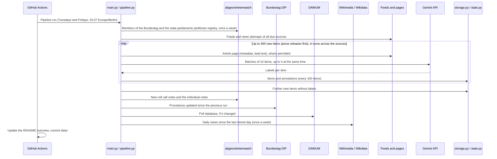

# German Politics Dataset
[](https://github.com/kleinnconrad/german_politics_dataset/actions/workflows/ci.yml)

> [!IMPORTANT]
> **The DIP API key expires on 31 May 2027.** Before that date, take the current key from the [DIP help page](https://dip.bundestag.de/%C3%BCber-dip/hilfe/api), replace the repository secret `DIP_API_KEY` (**Settings > Secrets and variables > Actions**) and the value in your local `.env`, and update the expiry date in `.github/workflows/pipeline.yml` (`DIP_KEY_VALID_UNTIL`) and in this note. The pipeline workflow shows a warning from 45 days before the date and fails from 14 days before, so that GitHub sends a notification.

A dataset of German politics for political analysis and the prediction of elections and other political events. A pipeline in GitHub Actions runs twice a week (Tuesdays and Fridays) for at most 30 minutes. It collects opinion polls, roll-call votes, parliamentary procedures, Wikipedia pageviews, news articles and press releases from public APIs, feeds and websites without bot protection, labels the news and press releases with Google Gemini (`gemini-2.5-flash`), and stores everything as partitioned JSON files in this repository.

## Table of Contents
- [Dataset Overview](#dataset-overview)
- [Datasets](#datasets)
- [Sources and Fetch Rules](#sources-and-fetch-rules)
- [Pipeline](#pipeline)
- [Data Files](#data-files)
- [Workflows](#workflows)
- [Configuration](#configuration)
- [Running Locally](#running-locally)
- [Continuous Integration](#continuous-integration)
- [Setup](#setup)
- [License](#license)

## Dataset Overview
<!-- DATASET_OVERVIEW_START -->
**Last updated:** 2026-10-19 19:16 UTC

| Dataset | Records | Items | Files | Observed | Content |
|---|---|---|---|---|---|
| `polls` | 3,980 | 3,980 | 1 | 2026-10-19 to 2026-10-19 | One published opinion poll (Sonntagsfrage). |
| `wikipedia_pageviews` | 993 | 993 | 1 | 2026-10-19 to 2026-10-19 | Daily views of the German Wikipedia article of a party or politician. |
| `news_items` | 0 | 0 | 0 | none | Metadata of one news article. The text is not stored. |
| `press_releases` | 0 | 0 | 0 | none | Metadata of one press release. The text is not stored. |
| `text_annotations` | 0 | 0 | 0 | none | Gemini labels of one news article or press release. |
| `roll_call_votes` | 247 | 247 | 1 | 2026-10-19 to 2026-10-19 | One roll-call vote (namentliche Abstimmung) in the Bundestag. |
| `mp_votes` | 172,677 | 172,677 | 1 | 2026-10-19 to 2026-10-19 | The vote of one member in one roll-call vote. |
| `parliamentary_procedures` | 19,265 | 19,265 | 1 | 2026-10-19 to 2026-10-19 | One parliamentary procedure (Vorgang) in the DIP, recorded when it appears or changes. |
| `politicians` | 2,513 | 2,513 | 1 | 2026-10-19 to 2026-10-19 | A politician with a current mandate, recorded when the entry appears or changes. |

**Runs**

- **Latest run:** 2026-10-19 18:42 UTC (backfill)
  - `parliamentary_procedures`: ok (parliamentary_procedures 19,265)
  - `politicians`: ok (politicians 2,513)
  - `polls`: ok (polls 3,980)
  - `roll_call_votes`: ok (mp_votes 172,677, roll_call_votes 247)
  - `wikipedia_pageviews`: ok (wikipedia_pageviews 993)

**Sources**

- **News outlets:** 40 configured (40 active)
- **Press-release sources:** 26 configured (26 active)

<details>
<summary>News outlets: items per source</summary>

| Source | Type | Status | Items | Last 30 days | Annotated | With lead text | Latest publication |
|---|---|---|---|---|---|---|---|
| Augsburger Allgemeine | regional daily | active | 0 | 0 | 0.0% (0) | 0.0% (0) | none |
| Berliner Zeitung | regional daily | active | 0 | 0 | 0.0% (0) | 0.0% (0) | none |
| Bild | tabloid | active | 0 | 0 | 0.0% (0) | 0.0% (0) | none |
| BR24 | public broadcaster regional | active | 0 | 0 | 0.0% (0) | 0.0% (0) | none |
| buten un binnen | public broadcaster regional | active | 0 | 0 | 0.0% (0) | 0.0% (0) | none |
| Der Spiegel | weekly magazine | active | 0 | 0 | 0.0% (0) | 0.0% (0) | none |
| Der Tagesspiegel | national daily | active | 0 | 0 | 0.0% (0) | 0.0% (0) | none |
| Deutschlandfunk | public broadcaster national | active | 0 | 0 | 0.0% (0) | 0.0% (0) | none |
| Die Welt | national daily | active | 0 | 0 | 0.0% (0) | 0.0% (0) | none |
| Focus Online | weekly magazine | active | 0 | 0 | 0.0% (0) | 0.0% (0) | none |
| Freie Presse | regional daily | active | 0 | 0 | 0.0% (0) | 0.0% (0) | none |
| Hamburger Abendblatt | regional daily | active | 0 | 0 | 0.0% (0) | 0.0% (0) | none |
| Handelsblatt | business | active | 0 | 0 | 0.0% (0) | 0.0% (0) | none |
| hessenschau.de | public broadcaster regional | active | 0 | 0 | 0.0% (0) | 0.0% (0) | none |
| Lausitzer Rundschau | regional daily | active | 0 | 0 | 0.0% (0) | 0.0% (0) | none |
| MDR | public broadcaster regional | active | 0 | 0 | 0.0% (0) | 0.0% (0) | none |
| n-tv.de | online only | active | 0 | 0 | 0.0% (0) | 0.0% (0) | none |
| NDR | public broadcaster regional | active | 0 | 0 | 0.0% (0) | 0.0% (0) | none |
| Neue Osnabrücker Zeitung | regional daily | active | 0 | 0 | 0.0% (0) | 0.0% (0) | none |
| Nordkurier | regional daily | active | 0 | 0 | 0.0% (0) | 0.0% (0) | none |
| Nürnberger Nachrichten | regional daily | active | 0 | 0 | 0.0% (0) | 0.0% (0) | none |
| rbb24 | public broadcaster regional | active | 0 | 0 | 0.0% (0) | 0.0% (0) | none |
| Rheinische Post | regional daily | active | 0 | 0 | 0.0% (0) | 0.0% (0) | none |
| Saarbrücker Zeitung | regional daily | active | 0 | 0 | 0.0% (0) | 0.0% (0) | none |
| shz.de | regional daily | active | 0 | 0 | 0.0% (0) | 0.0% (0) | none |
| Stuttgarter Zeitung | regional daily | active | 0 | 0 | 0.0% (0) | 0.0% (0) | none |
| SWR Aktuell | public broadcaster regional | active | 0 | 0 | 0.0% (0) | 0.0% (0) | none |
| Süddeutsche Zeitung | national daily | active | 0 | 0 | 0.0% (0) | 0.0% (0) | none |
| Südkurier | regional daily | active | 0 | 0 | 0.0% (0) | 0.0% (0) | none |
| t-online | online only | active | 0 | 0 | 0.0% (0) | 0.0% (0) | none |
| tagesschau.de | public broadcaster national | active | 0 | 0 | 0.0% (0) | 0.0% (0) | none |
| taz | national daily | active | 0 | 0 | 0.0% (0) | 0.0% (0) | none |
| Thüringer Allgemeine | regional daily | active | 0 | 0 | 0.0% (0) | 0.0% (0) | none |
| Trierischer Volksfreund | regional daily | active | 0 | 0 | 0.0% (0) | 0.0% (0) | none |
| Volksstimme | regional daily | active | 0 | 0 | 0.0% (0) | 0.0% (0) | none |
| WAZ | regional daily | active | 0 | 0 | 0.0% (0) | 0.0% (0) | none |
| WDR | public broadcaster regional | active | 0 | 0 | 0.0% (0) | 0.0% (0) | none |
| Weser-Kurier | regional daily | active | 0 | 0 | 0.0% (0) | 0.0% (0) | none |
| Wiesbadener Kurier | regional daily | active | 0 | 0 | 0.0% (0) | 0.0% (0) | none |
| ZDFheute | public broadcaster national | active | 0 | 0 | 0.0% (0) | 0.0% (0) | none |

</details>

<details>
<summary>Press-release sources: items per source</summary>

| Source | Type | Status | Items | Last 30 days | Annotated | With lead text | Latest publication |
|---|---|---|---|---|---|---|---|
| AfD | party | active | 0 | 0 | 0.0% (0) | 0.0% (0) | none |
| AfD-Fraktion im Bundestag | parliamentary group | active | 0 | 0 | 0.0% (0) | 0.0% (0) | none |
| Bayerische Staatsregierung | state government | active | 0 | 0 | 0.0% (0) | 0.0% (0) | none |
| Bundesministerium der Justiz und für Verbraucherschutz | federal ministry | active | 0 | 0 | 0.0% (0) | 0.0% (0) | none |
| Bundesministerium der Verteidigung | federal ministry | active | 0 | 0 | 0.0% (0) | 0.0% (0) | none |
| Bundesministerium des Innern | federal ministry | active | 0 | 0 | 0.0% (0) | 0.0% (0) | none |
| Bundesministerium für Bildung, Familie, Senioren, Frauen und Jugend | federal ministry | active | 0 | 0 | 0.0% (0) | 0.0% (0) | none |
| Bundesministerium für Digitales und Staatsmodernisierung | federal ministry | active | 0 | 0 | 0.0% (0) | 0.0% (0) | none |
| Bundesministerium für Gesundheit | federal ministry | active | 0 | 0 | 0.0% (0) | 0.0% (0) | none |
| Bundesministerium für Umwelt, Klimaschutz, Naturschutz und nukleare Sicherheit | federal ministry | active | 0 | 0 | 0.0% (0) | 0.0% (0) | none |
| Bundesministerium für wirtschaftliche Zusammenarbeit und Entwicklung | federal ministry | active | 0 | 0 | 0.0% (0) | 0.0% (0) | none |
| Bundesministerium für Wohnen, Stadtentwicklung und Bauwesen | federal ministry | active | 0 | 0 | 0.0% (0) | 0.0% (0) | none |
| Bundesrat | bundesrat | active | 0 | 0 | 0.0% (0) | 0.0% (0) | none |
| Bundesregierung | federal government | active | 0 | 0 | 0.0% (0) | 0.0% (0) | none |
| Bündnis 90/Die Grünen Bundestagsfraktion | parliamentary group | active | 0 | 0 | 0.0% (0) | 0.0% (0) | none |
| Bündnis Sahra Wagenknecht | party | active | 0 | 0 | 0.0% (0) | 0.0% (0) | none |
| CDU | party | active | 0 | 0 | 0.0% (0) | 0.0% (0) | none |
| CSU | party | active | 0 | 0 | 0.0% (0) | 0.0% (0) | none |
| Deutscher Bundestag | bundestag | active | 0 | 0 | 0.0% (0) | 0.0% (0) | none |
| Die Linke | party | active | 0 | 0 | 0.0% (0) | 0.0% (0) | none |
| FDP | party | active | 0 | 0 | 0.0% (0) | 0.0% (0) | none |
| Fraktion Die Linke im Bundestag | parliamentary group | active | 0 | 0 | 0.0% (0) | 0.0% (0) | none |
| Niedersächsische Landesregierung | state government | active | 0 | 0 | 0.0% (0) | 0.0% (0) | none |
| Saarländische Landesregierung | state government | active | 0 | 0 | 0.0% (0) | 0.0% (0) | none |
| SPD | party | active | 0 | 0 | 0.0% (0) | 0.0% (0) | none |
| SPD-Bundestagsfraktion | parliamentary group | active | 0 | 0 | 0.0% (0) | 0.0% (0) | none |

</details>

**Annotations**

- No news articles or press releases yet.

**Fields** (Filled: records with a value that is not null and not empty)

<details>
<summary><code>polls</code>: 21 fields</summary>

| Field | Description | Filled | Distinct values |
|---|---|---|---|
| `record_id` | Stable id of the item. Together with revision it identifies a record. | 100.0% (3,980) | 3,980 |
| `revision` | 0 for the first observation; incremented each time the source changes the item. | 100.0% (3,980) | 1 |
| `dataset` | Name of the dataset. | 100.0% (3,980) | 1 |
| `schema_version` | Version of the record schema. | 100.0% (3,980) | 1 |
| `observed_at` | UTC time at which the pipeline observed this version of the item. Filtering observed_at <= t gives the state of knowledge at time t. | 100.0% (3,980) | 2 |
| `source_id` | Id of the source (API, outlet or press source). | 100.0% (3,980) | 1 |
| `source_url` | URL of the item or of the API resource it was read from. | 100.0% (3,980) | 1 |
| `license` | License or terms of the source. | 100.0% (3,980) | 1 |
| `jurisdiction` | DE for the federal level, ISO 3166-2 code for a state. | 100.0% (3,980) | 17 |
| `backfilled` | True if the item is older than the start of collection for its dataset, so that observed_at does not reflect when it became public. | 100.0% (3,980) | 2 |
| `poll_id` | Id of the poll at DAWUM. | 100.0% (3,980) | 3,980 |
| `parliament` | Parliament the poll asks about. | 100.0% (3,980) | 3 |
| `institute` | Polling institute. | 100.0% (3,980) | 22 |
| `tasker` | Client that commissioned the poll. | 100.0% (3,980) | 119 |
| `method` | Survey method. | 100.0% (3,980) | 6 |
| `fieldwork_start` | First day of the fieldwork. | 100.0% (3,980) | 2,163 |
| `fieldwork_end` | Last day of the fieldwork. | 100.0% (3,980) | 2,208 |
| `published_date` | Publication date of the poll. | 100.0% (3,980) | 2,432 |
| `sample_size` | Number of respondents. | 100.0% (3,980) | 1,061 |
| `results` | Vote intention in percent by party code, without the others. | 100.0% (3,980) | 25 |
| `others_share` | Share of all other parties in percent. | 100.0% (3,980) | 64 |

</details>

<details>
<summary><code>wikipedia_pageviews</code>: 15 fields</summary>

| Field | Description | Filled | Distinct values |
|---|---|---|---|
| `record_id` | Stable id of the item. Together with revision it identifies a record. | 100.0% (993) | 993 |
| `revision` | 0 for the first observation; incremented each time the source changes the item. | 100.0% (993) | 1 |
| `dataset` | Name of the dataset. | 100.0% (993) | 1 |
| `schema_version` | Version of the record schema. | 100.0% (993) | 1 |
| `observed_at` | UTC time at which the pipeline observed this version of the item. Filtering observed_at <= t gives the state of knowledge at time t. | 100.0% (993) | 148 |
| `source_id` | Id of the source (API, outlet or press source). | 100.0% (993) | 1 |
| `source_url` | URL of the item or of the API resource it was read from. | 100.0% (993) | 993 |
| `license` | License or terms of the source. | 100.0% (993) | 1 |
| `jurisdiction` | DE for the federal level, ISO 3166-2 code for a state. | 100.0% (993) | 1 |
| `backfilled` | True if the item is older than the start of collection for its dataset, so that observed_at does not reflect when it became public. | 100.0% (993) | 1 |
| `entity_id` | Party code, or politician id at abgeordnetenwatch. | 100.0% (993) | 993 |
| `entity_type` | Type of the entity. | 100.0% (993) | 2 |
| `wikipedia_title` | Title of the article in the German Wikipedia. | 100.0% (993) | 993 |
| `wikidata_qid` | Wikidata id of the entity. | 98.9% (982) | 982 |
| `daily_views` | Views by human users per day (UTC), for the days since the previous run. | 100.0% (993) | 4,128 |

</details>

<details>
<summary><code>roll_call_votes</code>: 25 fields</summary>

| Field | Description | Filled | Distinct values |
|---|---|---|---|
| `record_id` | Stable id of the item. Together with revision it identifies a record. | 100.0% (247) | 247 |
| `revision` | 0 for the first observation; incremented each time the source changes the item. | 100.0% (247) | 1 |
| `dataset` | Name of the dataset. | 100.0% (247) | 1 |
| `schema_version` | Version of the record schema. | 100.0% (247) | 1 |
| `observed_at` | UTC time at which the pipeline observed this version of the item. Filtering observed_at <= t gives the state of knowledge at time t. | 100.0% (247) | 13 |
| `source_id` | Id of the source (API, outlet or press source). | 100.0% (247) | 1 |
| `source_url` | URL of the item or of the API resource it was read from. | 100.0% (247) | 247 |
| `license` | License or terms of the source. | 100.0% (247) | 1 |
| `jurisdiction` | DE for the federal level, ISO 3166-2 code for a state. | 100.0% (247) | 1 |
| `backfilled` | True if the item is older than the start of collection for its dataset, so that observed_at does not reflect when it became public. | 100.0% (247) | 2 |
| `vote_id` | Id of the vote at abgeordnetenwatch. | 100.0% (247) | 247 |
| `parliament_period` | Electoral period, e.g. 'Bundestag 2025 - 2029'. | 100.0% (247) | 2 |
| `vote_date` | Date of the vote. | 100.0% (247) | 124 |
| `title` | Title of the vote. | 100.0% (247) | 240 |
| `topics` | Topics assigned by abgeordnetenwatch. | 99.2% (245) | 29 |
| `committees` | Committees in charge. | 79.8% (197) | 26 |
| `printed_papers` | Numbers of the Bundestag printed papers (Drucksachen) linked in the description of the vote, e.g. '21/7869'. They link the vote to procedures in the DIP (filter f.dokumentnummer). | 99.2% (245) | 419 |
| `accepted` | Whether the motion was accepted. | 100.0% (247) | 2 |
| `yes` | Number of yes votes. | 100.0% (247) | 180 |
| `no` | Number of no votes. | 100.0% (247) | 178 |
| `abstain` | Number of abstentions. | 100.0% (247) | 46 |
| `no_show` | Number of members who did not vote. | 100.0% (247) | 104 |
| `by_faction` | Counts of yes, no, abstain and no_show by parliamentary group at the time of the vote (party code, NONE for members without a group). | 100.0% (247) | 8 |
| `cohesion` | Rice index \|yes - no\| / (yes + no) per parliamentary group; null if the group cast no yes or no votes. Members without a group (NONE) are not included. | 100.0% (247) | 7 |
| `defectors` | Members per parliamentary group who voted yes while the group cast more no than yes votes, or no while it cast more yes than no votes. Members without a group (NONE) are not included. | 100.0% (247) | 7 |

</details>

<details>
<summary><code>mp_votes</code>: 16 fields</summary>

| Field | Description | Filled | Distinct values |
|---|---|---|---|
| `record_id` | Stable id of the item. Together with revision it identifies a record. | 100.0% (172,677) | 172,677 |
| `revision` | 0 for the first observation; incremented each time the source changes the item. | 100.0% (172,677) | 1 |
| `dataset` | Name of the dataset. | 100.0% (172,677) | 1 |
| `schema_version` | Version of the record schema. | 100.0% (172,677) | 1 |
| `observed_at` | UTC time at which the pipeline observed this version of the item. Filtering observed_at <= t gives the state of knowledge at time t. | 100.0% (172,677) | 16 |
| `source_id` | Id of the source (API, outlet or press source). | 100.0% (172,677) | 1 |
| `source_url` | URL of the item or of the API resource it was read from. | 100.0% (172,677) | 172,677 |
| `license` | License or terms of the source. | 100.0% (172,677) | 1 |
| `jurisdiction` | DE for the federal level, ISO 3166-2 code for a state. | 100.0% (172,677) | 1 |
| `backfilled` | True if the item is older than the start of collection for its dataset, so that observed_at does not reflect when it became public. | 100.0% (172,677) | 2 |
| `vote_id` | Id of the vote at abgeordnetenwatch. | 100.0% (172,677) | 247 |
| `vote_date` | Date of the vote. | 100.0% (172,677) | 124 |
| `politician_id` | Id of the politician at abgeordnetenwatch. | 100.0% (172,677) | 1,008 |
| `faction` | Parliamentary group at the time of the vote as party code, NONE for members without a group. | 100.0% (172,677) | 8 |
| `vote` | The member's vote. | 100.0% (172,677) | 4 |
| `voted_against_faction` | True if the member voted yes while the group cast more no than yes votes, or no while it cast more yes than no votes. Always false for members without a group. | 100.0% (172,677) | 2 |

</details>

<details>
<summary><code>parliamentary_procedures</code>: 24 fields</summary>

| Field | Description | Filled | Distinct values |
|---|---|---|---|
| `record_id` | Stable id of the item. Together with revision it identifies a record. | 100.0% (19,265) | 19,265 |
| `revision` | 0 for the first observation; incremented each time the source changes the item. | 100.0% (19,265) | 1 |
| `dataset` | Name of the dataset. | 100.0% (19,265) | 1 |
| `schema_version` | Version of the record schema. | 100.0% (19,265) | 1 |
| `observed_at` | UTC time at which the pipeline observed this version of the item. Filtering observed_at <= t gives the state of knowledge at time t. | 100.0% (19,265) | 21 |
| `source_id` | Id of the source (API, outlet or press source). | 100.0% (19,265) | 1 |
| `source_url` | URL of the item or of the API resource it was read from. | 100.0% (19,265) | 19,265 |
| `license` | License or terms of the source. | 100.0% (19,265) | 1 |
| `jurisdiction` | DE for the federal level, ISO 3166-2 code for a state. | 100.0% (19,265) | 1 |
| `backfilled` | True if the item is older than the start of collection for its dataset, so that observed_at does not reflect when it became public. | 100.0% (19,265) | 1 |
| `procedure_id` | Id of the procedure in the DIP. | 100.0% (19,265) | 19,265 |
| `change` | new for the first observation, status_changed if the status changed, updated for other tracked changes. | 100.0% (19,265) | 1 |
| `procedure_type` | Type of the procedure, e.g. Gesetzgebung, Antrag, Kleine Anfrage. | 100.0% (19,265) | 43 |
| `electoral_period` | Electoral period of the Bundestag. | 100.0% (19,265) | 1 |
| `title` | Title of the procedure. | 100.0% (19,265) | 18,966 |
| `initiators` | Initiators, e.g. Bundesregierung, Bundesrat or a parliamentary group. | 39.8% (7,666) | 85 |
| `subject_areas` | Subject areas (Sachgebiete) of the DIP. | 26.2% (5,055) | 28 |
| `descriptors` | Subject descriptors of the DIP thesaurus. | 88.6% (17,077) | 7,907 |
| `consent_required` | Whether the consent of the Bundesrat is required, from the latest statement of the DIP (bill, Bundestag decision or promulgation); null if not stated. | 2.3% (450) | 2 |
| `status` | Current status (Beratungsstand). | 83.6% (16,104) | 25 |
| `previous_status` | Status at the previous observation; null for new procedures. | 0.0% (0) | 0 |
| `gesta_id` | GESTA id of a bill. | 2.3% (450) | 450 |
| `dip_updated_at` | Last update of the procedure in the DIP (UTC). | 100.0% (19,265) | 8,296 |
| `latest_document_date` | Date of the latest document of the procedure (DIP field datum), e.g. of the printed paper or plenary record that set the current status. | 100.0% (19,265) | 383 |

</details>

<details>
<summary><code>politicians</code>: 17 fields</summary>

| Field | Description | Filled | Distinct values |
|---|---|---|---|
| `record_id` | Stable id of the item. Together with revision it identifies a record. | 100.0% (2,513) | 2,513 |
| `revision` | 0 for the first observation; incremented each time the source changes the item. | 100.0% (2,513) | 1 |
| `dataset` | Name of the dataset. | 100.0% (2,513) | 1 |
| `schema_version` | Version of the record schema. | 100.0% (2,513) | 1 |
| `observed_at` | UTC time at which the pipeline observed this version of the item. Filtering observed_at <= t gives the state of knowledge at time t. | 100.0% (2,513) | 1 |
| `source_id` | Id of the source (API, outlet or press source). | 100.0% (2,513) | 1 |
| `source_url` | URL of the item or of the API resource it was read from. | 100.0% (2,513) | 2,513 |
| `license` | License or terms of the source. | 100.0% (2,513) | 1 |
| `jurisdiction` | DE for the federal level, ISO 3166-2 code for a state. | 100.0% (2,513) | 17 |
| `backfilled` | True if the item is older than the start of collection for its dataset, so that observed_at does not reflect when it became public. | 100.0% (2,513) | 1 |
| `politician_id` | Id of the politician at abgeordnetenwatch. | 100.0% (2,513) | 2,513 |
| `name` | Full name. | 100.0% (2,513) | 2,507 |
| `party` | Current party as party code; NONE without party; OTHER for parties not in the registry; null if unknown. | 100.0% (2,513) | 12 |
| `sex` | Sex as stated by abgeordnetenwatch. | 99.6% (2,504) | 3 |
| `year_of_birth` | Year of birth. | 87.8% (2,207) | 59 |
| `wikidata_qid` | Wikidata id. | 39.1% (982) | 982 |
| `mandates` | Current mandates with parliament, period, faction (party code, NONE without group), constituency and electoral_list the member stood in (null if none), mandate_won (constituency, list or moved_up), start_date and end_date (YYYY-MM-DD; null if equal to the start or end of the period). | 100.0% (2,513) | 2,335 |

</details>
<!-- DATASET_OVERVIEW_END -->

## Datasets

| Dataset | Content | Source | Kind |
|---|---|---|---|
| `polls` | Opinion polls (Sonntagsfrage) for the Bundestag, the 16 state parliaments and the European Parliament, since 2017 | DAWUM | event |
| `wikipedia_pageviews` | Daily views of the German Wikipedia articles of parties (since July 2015) and members of parliament | Wikimedia | event |
| `news_items` | Metadata of political news articles of German outlets | RSS feeds, news sitemaps, article pages | event |
| `press_releases` | Metadata of press releases of the federal government, ministries, parliaments, parliamentary groups, parties and courts | RSS feeds | event |
| `text_annotations` | Gemini labels of up to 400 news articles and press releases per run (press releases first): topic, event types, parties and politicians with role and tone, frame, conflicts, polls, upcoming events | Gemini | event |
| `roll_call_votes` | Roll-call votes of the Bundestag with counts, cohesion and defectors per parliamentary group, and the printed papers (Drucksachen) they refer to | abgeordnetenwatch.de | event |
| `mp_votes` | The vote of each member in each roll-call vote | abgeordnetenwatch.de | event |
| `parliamentary_procedures` | Procedures of the Bundestag and Bundesrat (bills, motions, interpellations), recorded when they appear or change | Bundestag DIP | change |
| `politicians` | Members of the Bundestag and the 16 state parliaments with party, mandates and Wikidata id, recorded when they appear or change | abgeordnetenwatch.de | change |

**Fields of every record:** `record_id`, `revision`, `dataset`, `schema_version`, `observed_at`, `source_id`, `source_url`, `license`, `jurisdiction`, `backfilled`. All other fields are defined with descriptions in [src/schema.py](src/schema.py); the variables and the prediction targets they serve are described in [project_architecture.md](project_architecture.md).

**Point-in-time correctness.** `observed_at` is the time at which the pipeline observed the item. Filtering `observed_at <= t` gives the state of knowledge at time t, so that models can be tested on past data without information from the future. Records of items that are older than the start of collection (e.g. the poll history) have `backfilled: true`.

**Revisions.** Event datasets store each item once. If a source changes an item (e.g. DAWUM corrects a poll), a new record with the same `record_id` and the next `revision` is written. Change datasets write a record for each observed change. The valid version at time t is the record with the highest revision observed at or before t.

**No full texts.** News articles and press releases are stored as titles, URLs, metadata and derived variables. The lead text that Gemini reads is not stored.

**Annotated sample.** Every new political item of a run is stored in `news_items` or `press_releases`. Up to 400 of them are annotated: all press releases, then news items in turns across the outlets, newest first. The other items are stored from the feed data without labels, so that the item counts per outlet stay complete and the annotated sample can be weighted against them.

## Sources and Fetch Rules

- **APIs:** DAWUM (polls), abgeordnetenwatch.de API v2 (politicians, roll-call votes; at most 30 requests per minute), Bundestag DIP API (procedures; API key), Wikimedia Pageviews API, MediaWiki and Wikidata APIs (article titles). These documented APIs are used under their API terms.
- **Websites:** the news outlets and press-release sources in [config/sources.toml](config/sources.toml), read through RSS/Atom feeds, news sitemaps and, where permitted, the article pages.
- **robots.txt:** every website request is checked against the robots.txt of its host for the user agent `GermanPoliticsDataset`, with the longest-match rule of RFC 9309. A crawl delay is honored; a host that requires more than 120 seconds is not fetched. A host whose robots.txt cannot be fetched is not requested again in the same run.
- **Bot protection:** a source that answers with HTTP 401/403, a challenge page or a CAPTCHA is set to `blocked` and is not fetched again until it is reset by hand. The pipeline does not use a headless browser.
- **Text and data mining reservations:** a source whose host or pages declare a machine-readable reservation (TDMRep header, `/.well-known/tdmrep.json` or meta tag) is set to `tdm_reserved` and is not used. For outlets whose robots.txt states a reservation under § 44b UrhG in plain text, article pages are not fetched (`fetch_pages = false`); their feed items are used with title and teaser only.
- **Pacing:** at most one request per second per host (abgeordnetenwatch: one per 2.1 seconds), retries for server errors and rate limits.
- **Broken sources:** a source whose feeds fail on 7 consecutive runs is `broken` and is retried weekly.

## Pipeline



The feeds run right after the politician registry, because news items leave the feeds after a few days; the data of the later collectors can also be fetched by a later run. `politicians` and `wikipedia_pageviews` run once a week, six days or more after their last complete run; pageviews are fetched for all days since the last stored day, so no day is lost.

**Run deadline.** The collectors start no new work 25 minutes after the start of the run (`RUN_DEADLINE_MINUTES`), so that the workflow commits the data before its timeout of 30 minutes. A collector that stops at the deadline has the status `partial` and continues in the next run; a collector that has not started by then is skipped. Items of the feeds that are not annotated by the deadline are stored without labels.

Each collector runs in isolation: a failure is logged in `data/state/collectors.json` and the run log, the other collectors continue, and the data already written is kept. The run then ends with exit code 1, so that the workflow fails visibly.

## Data Files

| Path | Content |
|---|---|
| `data/<dataset>/year=YYYY/month=MM/<dataset>_YYYY-MM-DD.json` | Records of a dataset observed on one UTC day |
| `data/state/seen/<dataset>.json` | Items already written, with content hash and revision |
| `data/state/collectors.json` | First run, last run, failures and cursor per collector |
| `data/state/sources.json` | Health status of the news and press-release sources |
| `data/state/politicians.json` | Politician registry used to resolve names in the annotations |
| `data/state/run_log.jsonl` | One line per run with the outcome and counters of each collector |
| `data/LICENSE.md` | License and attribution of the data |

Each data file is a JSON list with one record per line. The folder names `year=` and `month=` let DuckDB, Polars and pyarrow read a dataset as one table:

```python
import duckdb
polls = duckdb.sql("select * from read_json('data/polls/**/*.json', hive_partitioning=true)").df()
```

## Workflows

| Workflow | Schedule | Purpose |
|---|---|---|
| `pipeline.yml` | Tuesdays and Fridays, 02:07 Europe/Berlin | Runs the due collectors (timeout 30 minutes), updates the overview and commits `data/` and `README.md` |
| `notify.yml` | After each `normal` or `backfill` run of `pipeline.yml` | Posts a summary of the run (status and records per collector, annotated items, Gemini tokens and estimated cost) as a commit comment that mentions the repository owner |
| `ci.yml` | Pull requests, pushes to `main` | Lint, tests and commit message checks |

**Notification email.** GitHub sends an email for the mention in the comment of `notify.yml` if email notifications for participating and @mentions are enabled (the default, under **Settings > Notifications** of the GitHub account). The summary is built by `scripts/run_summary.py` from the last line of `data/state/run_log.jsonl`; the cost estimate uses the list prices in that script. `notify.yml` runs only once it is on the default branch.

**Manual runs.** Both workflows can be started by hand: open the **Actions** tab, select **German Politics Pipeline** (or **CI**), click **Run workflow**, and choose the branch and the `mode`. The button appears once the workflow file is on the default branch. The modes of `pipeline.yml`:
- `normal`: same as the scheduled run; commits the data.
- `backfill`: imports the history of all collectors except the feeds, without the per-run caps and the weekly interval, and commits it (timeout 90 minutes, deadline 85 minutes). Run it once before the first `normal` run (see [Setup](#setup)).
- `shadow`: runs on a copy of the state in a temporary folder and uploads the output as an artifact; nothing is committed. Uses the same API keys and quotas.
- `dry-run`: runs the collectors without writing any data; the feeds collector reads the feeds and sitemaps only (no article pages, no Gemini calls). The workflow log lists the new items per source and the counts.

The input `collectors` restricts a manual run to a comma-separated list of collectors, e.g. `feeds`; selected collectors run even if they are not due. For a first test, start with `dry-run` and `collectors` set to `feeds` (checks access to the sources and the number of new items per source), then `backfill`, then `shadow` (checks the API keys and a regular run without committing), then `normal`.

## Configuration

| Variable | Default | Purpose |
|---|---|---|
| `GEMINI_API_KEY` | none | Gemini API key (required for news and press releases) |
| `DIP_API_KEY` | none | Bundestag DIP API key (required for the procedures) |
| `GEMINI_MODEL` | `gemini-2.5-flash` | Model for the annotation; stored in every annotation record |
| `MAX_GEMINI_CALLS_PER_RUN` | 50 | Gemini requests per run, including retries |
| `MAX_ANNOTATIONS_PER_RUN` | 400 | News articles and press releases annotated per run; further new items are stored without labels |
| `GEMINI_CONCURRENCY` | 4 | Gemini requests sent at the same time; 1 for the free tier of the Gemini API |
| `NEWS_LOOKBACK_HOURS` | 96 | Age limit of new feed and sitemap items |
| `NEWS_FETCH_PAGES` | on | Fetch article pages for metadata and lead text |
| `RUN_DEADLINE_MINUTES` | 25 | Minutes after the start after which the collectors start no new work (85 in `backfill` runs) |
| `COLLECTORS` | all due | Comma-separated list of collectors to run; listed collectors run even if they are not due |

Fixed thresholds, such as the source status rules, are constants in the modules that use them.

## Running Locally

```bash
uv sync
uv run python src/main.py --dry-run --collectors feeds          # read the feeds only
uv run python src/main.py --backfill                             # import the history (no feeds)
uv run python src/main.py --collectors polls,wikipedia_pageviews # selected collectors
uv run python src/main.py --max-annotations 20                   # a short full run
uv run python src/generate_dataset_overview.py                   # README overview
```

Secrets are read from a `.env` file in the repository root (`GEMINI_API_KEY=...`, `DIP_API_KEY=...`); the file is listed in `.gitignore`. Local runs write to `~/Downloads/german_politics_dataset/` unless `--output-dir` is given; in GitHub Actions they write to `data/`. The collectors, in the order of a run, are `politicians`, `feeds`, `roll_call_votes`, `parliamentary_procedures`, `polls` and `wikipedia_pageviews`.

## Continuous Integration

The `CI` workflow runs on every pull request and on pushes to `main`:

| Job | Checks |
|---|---|
| `Lint` | `uv.lock` matches `pyproject.toml`; `ruff check`; `actionlint` (including `shellcheck`) on the workflow files |
| `Tests` | The tests in `tests/` on Python 3.11 and 3.14. They run offline, with a fake web and a fake Gemini client, and check that every module imports with the locked dependencies. |
| `Conventional Commits` | Every commit of a pull request follows the Conventional Commits format (pull requests only) |
| `CI passed` | Succeeds only if all jobs above succeeded or were skipped; use it as the required status check of `main` |

Dependencies are managed with [uv](https://docs.astral.sh/uv/): `pyproject.toml` declares them, `uv.lock` pins them, and Dependabot proposes weekly updates. Run the checks locally before pushing:

```bash
uv lock --check
uv run ruff check .
uv run pytest
```

## Setup

1. Add the repository secrets `GEMINI_API_KEY` and `DIP_API_KEY` under **Settings > Secrets and variables > Actions**. The current public DIP key is listed on the [DIP help page](https://dip.bundestag.de/%C3%BCber-dip/hilfe/api); it is replaced from time to time.
2. Allow workflows to push to the repository under **Settings > Actions > General > Workflow permissions** (read and write permissions).
3. Start `pipeline.yml` once by hand in the mode `backfill` before the first scheduled run. It imports the history: all polls since 2017, the pageviews of the party articles since July 2015 and of the members of parliament for one year, all procedures of the current electoral period, and the roll-call votes of the current and the previous electoral period (about 250, at the rate limit of abgeordnetenwatch). It takes about 40 minutes. The regular runs then fetch only the changes; without the backfill, they import the history over several runs, at most 120 roll-call votes per run and within the run deadline.

## License

- **Code:** MIT License, see [LICENSE](LICENSE).
- **Data** (`data/`): Open Database License (ODbL) 1.0, individual contents under the Database Contents License (DbCL) 1.0, see [data/LICENSE.md](data/LICENSE.md). The poll data comes from [DAWUM](https://dawum.de/) under the ODbL. Titles and URLs of news articles and press releases remain subject to the rights of their publishers.
